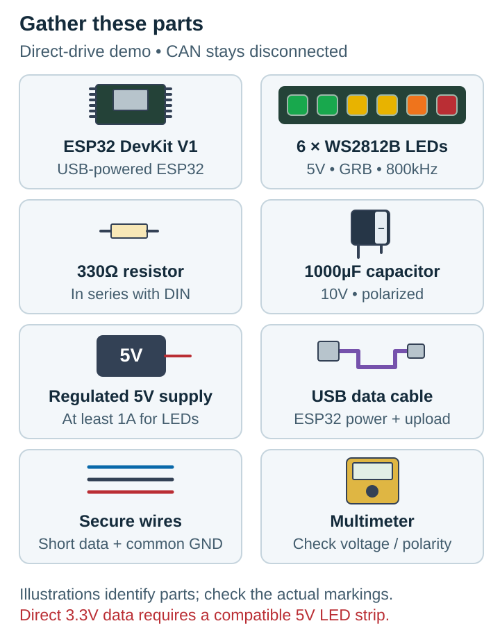
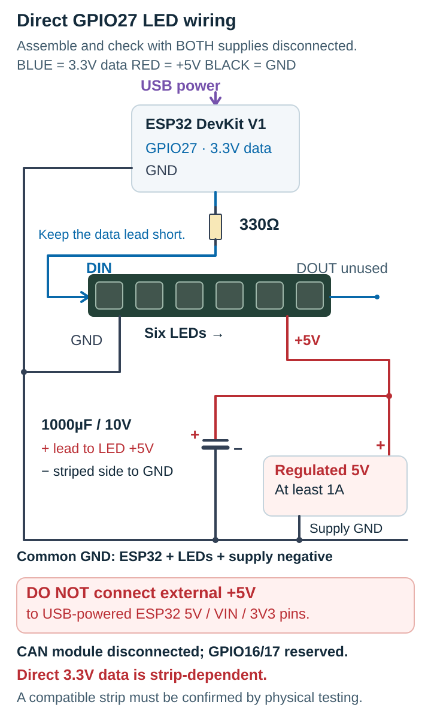
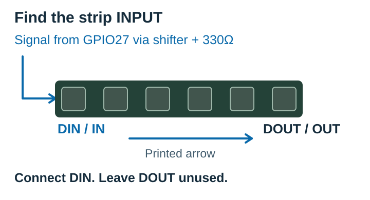
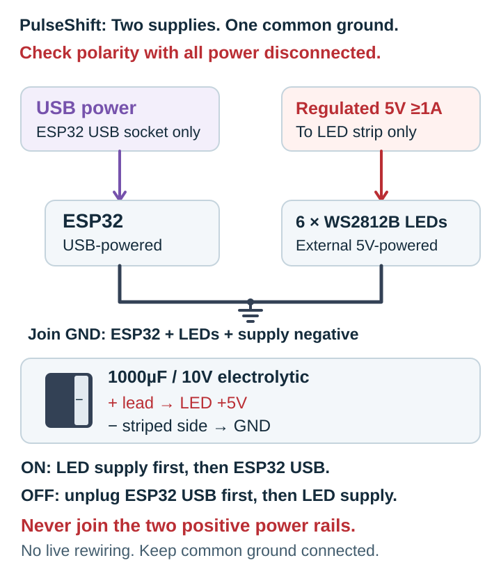
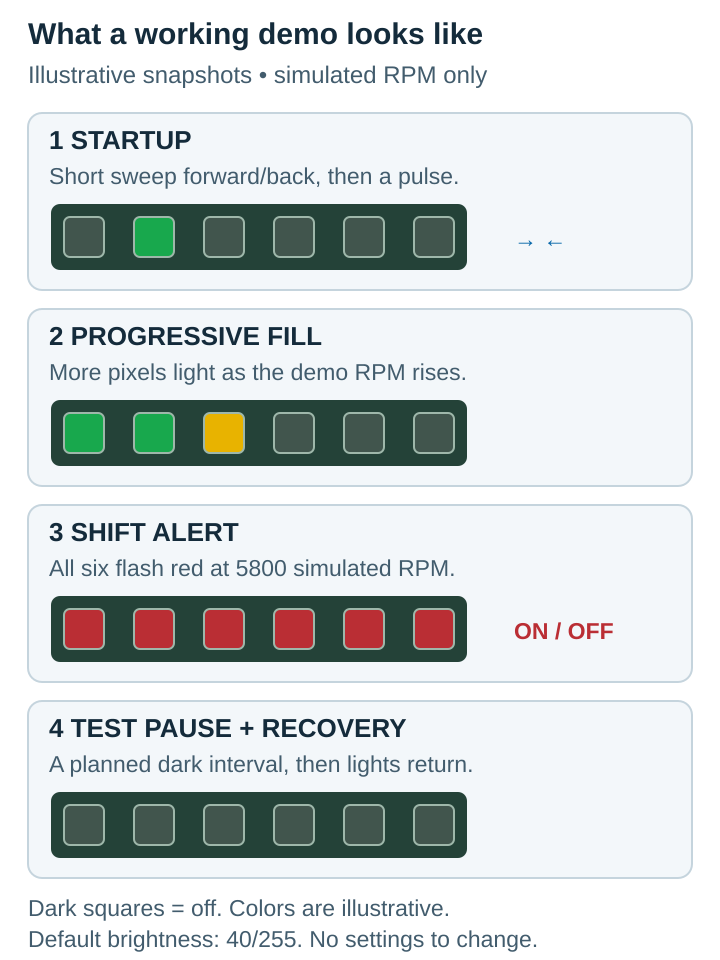

# REVIX LINK

A six-LED ESP32 demonstration that turns simulated engine speed into a rising light bar and a flashing shift alert.

## What this does

The LEDs run a repeating demonstration without a motorcycle, CAN module or screen. **The standard build needs no settings changed:** GPIO27, six WS2812B LEDs, brightness 40/255 and Classic colors. OLED is off by default.

**[Download the current release: v0.1.0 Arduino Preview](https://github.com/iamaritrasaha/REVIX-LINK/releases/tag/v0.1.0)**

Choose **REVIX-LINK-Arduino-v0.1.0.zip** under Assets, not the GitHub source-code ZIP. This is a standalone demo, not motorcycle-ready firmware.

## What you need

- ESP32 DevKit V1 and a USB **data** cable.
- One six-LED **5V WS2812B strip**, GRB / 800kHz.
- **SN74AHCT125N** DIP-14 level shifter.
- One **330Ω** resistor and one **10kΩ** resistor.
- One **1000µF, 10V** electrolytic capacitor and one **100nF** ceramic capacitor.
- Regulated **5V supply rated at least 1A**, secure wires and a breadboard or soldered board.
- A multimeter to check voltage and polarity.

The optional SN65HVD230 is **not needed or connected** for this demo.

## How to wire it

Disconnect all power before wiring. Follow the pin numbers on the **SN74AHCT125N**, not guessed ESP32 header positions. Viewed from above with its notch up, DIP pins 1..7 run down the left side and 8..14 up the right. The diagram is a connection map; all **GND** labels must connect together.

Connect the signal to **DIN**, following the strip's printed arrow. Leave **DOUT** empty. Keep the 330Ω resistor close to the first LED and the 100nF capacitor close to shifter pins 14 and 7.

**USB powers the ESP32. External 5V powers only the LEDs and shifter.** Share ground, but never join external +5V to the USB-powered ESP32's 5V, VIN or 3V3 pins. Never power the strip from a GPIO.

Check voltage and capacitor polarity before power-on. Switch on LED/shifter power first, then connect ESP32 USB. Disconnect USB first when switching off. Let the capacitor discharge before rewiring. [Full wiring and power details](arduino/README.txt) are available if you need them. Tap any diagram to enlarge it.

## How to install it

Keep the motorcycle disconnected. Use **Arduino IDE 2.x for Linux inside Ubuntu WSL2/WSLg**. Keep the project, board core and libraries inside WSL, not Windows.

1. Download and extract the release ZIP into your WSL home folder. Keep the `REVIX_LINK` folder intact and open `REVIX_LINK.ino`.
2. In IDE Preferences, add the [Espressif board-manager URL](https://espressif.github.io/arduino-esp32/package_esp32_index.json) to **Additional Boards Manager URLs**. In Boards Manager, install **esp32 by Espressif Systems 2.0.17**.
3. In Library Manager, install **Adafruit NeoPixel 1.12.3**. The default demo does not need OLED libraries.
4. Select **Tools → Board → ESP32 Arduino → ESP32 Dev Module**. Leave `UserConfig.h` unchanged.
5. Follow the power order above, then select your board under **Tools → Port**. USB must be available inside WSL; if no port appears, resolve that before continuing.
6. Click **Verify**, then **Upload**. After upload, the demonstration starts automatically.

Need the Linux IDE or command-line setup? See [Arduino's IDE installation guide](https://docs.arduino.cc/software/ide-v2/tutorials/getting-started/ide-v2-downloading-and-installing/) and the [included WSL guide](arduino/README.txt). Repository development and Wokwi instructions are also in that guide.

## What happens after upload

Expect a short startup animation, then a growing light bar. All six LEDs flash red at the simulated shift point. The test also deliberately stops valid data, so a dark interval followed by recovery is normal. It is not measuring real engine RPM.

## Common mistakes

- **Connecting DOUT instead of DIN.** Follow the printed arrow into the first LED.
- **Reversing the large capacitor.** Positive goes to +5V; the striped negative side goes to GND.
- **Forgetting common ground.** Join ESP32, strip, shifter and supply negative.
- **Joining the two positive supplies.** Keep external +5V away from the USB-powered ESP32's power pins.
- **Skipping the shifter or using the wrong chip.** Use SN74AHCT125N, not 74HC125 or an I2C level-shifter board.
- **Changing wires while powered.** Disconnect both supplies first; check wiring and power before blaming the code.

## What you can change

These are optional. The standard hardware works with the defaults in [UserConfig.h](UserConfig.h).

- **Brightness:** `REVIX_LED_BRIGHTNESS`, default **40**, range 0..255. Brightness is not a hardware current limiter.
- **Style:** `REVIX_SHIFT_LIGHT_STYLE`, default **Classic**; Racing, Minimal and Custom are also available.
- **LED direction:** `REVIX_LED_DIRECTION`, default **Normal**. Reversed changes the light pattern, not which end is DIN.

Rebuild and upload after changing a setting. [Advanced options](arduino/README.txt) stay in the detailed guide.

## Important note

**The default demo works without CAN.** GPIO16 and GPIO17 remain reserved for later receiver work. The CAN bitrate defaults to 0, and motorcycle RPM decoding is not enabled.

The **2025 Indian Bajaj Pulsar NS125 ABS is not yet verified for plug-and-play RPM integration**. SN65HVD230 is reserved for later verified CAN work. Even a six-pin breakout needs its actual RS wiring, termination and electrical passivity checked before bus connection. Isolated bench CAN testing is a separate setup, described in the detailed guide.

Copyright (c) 2026 Aritra Saha. All rights reserved. See [COPYRIGHT](COPYRIGHT).
