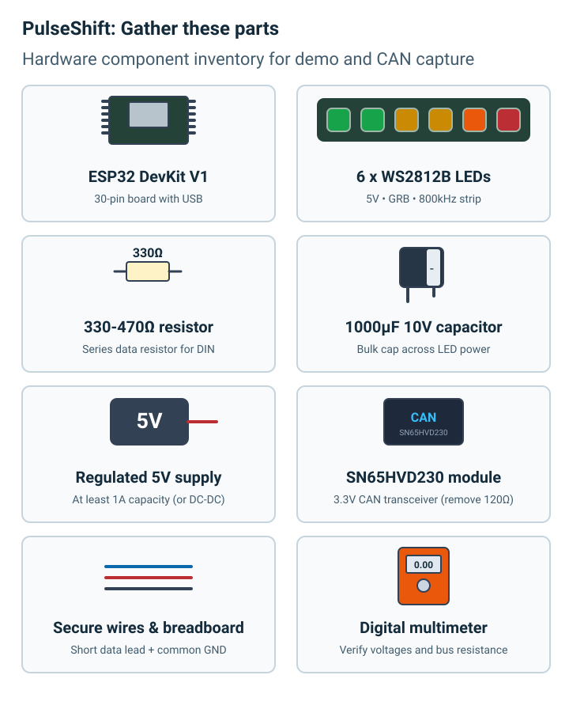
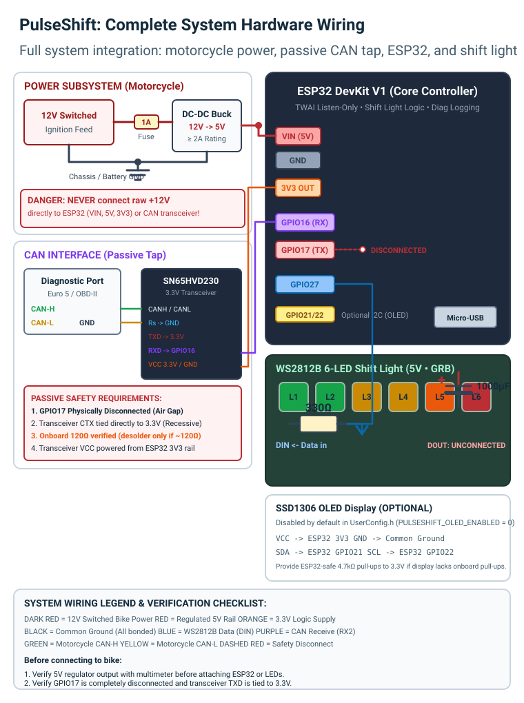
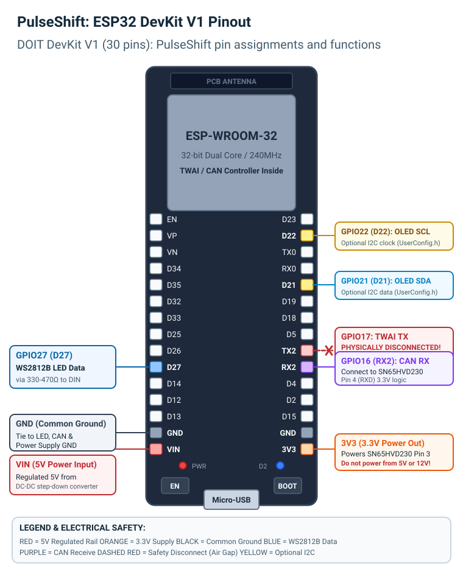
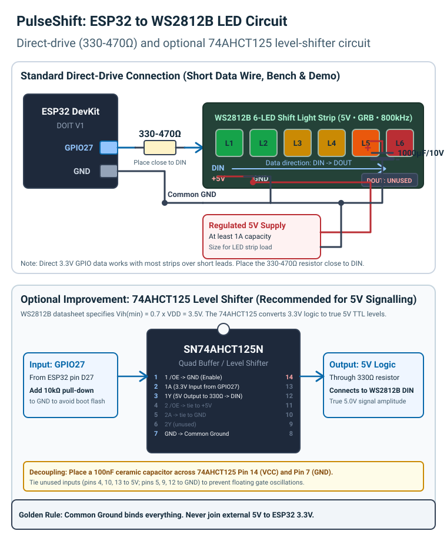
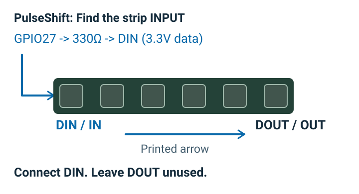
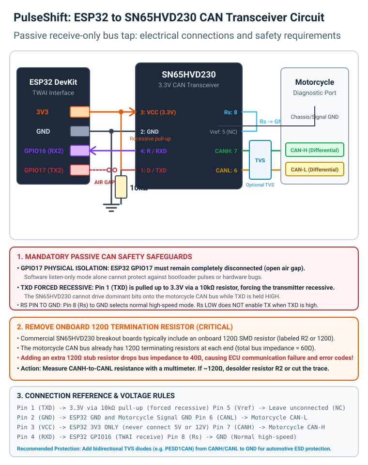
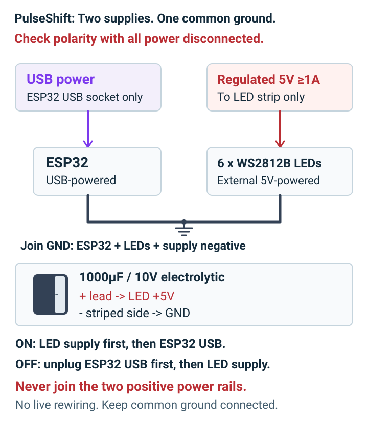
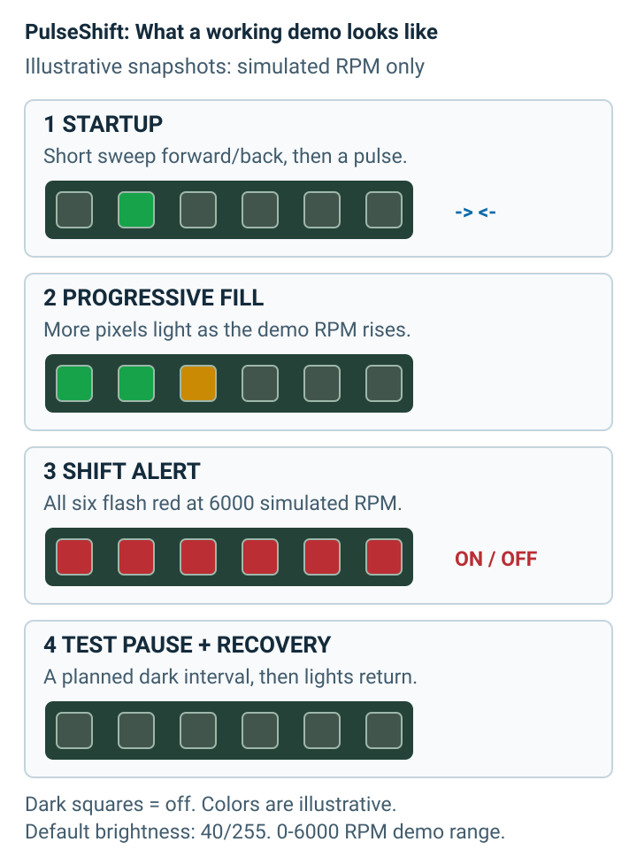

# PulseShift

Customizable ESP32 motorcycle shift-light firmware. Six WS2812B LEDs light up progressively with engine RPM. At 6000 RPM all LEDs flash red as the shift alert. No motorcycle is needed to try it: the default Demo mode runs a full RPM simulation on its own.

## What it does

- **Demo mode**: runs an autonomous synthetic RPM sweep from 0 to 6000 RPM and back, showing the shift light in action. No CAN connection needed.
- **CAN Capture mode**: passively records raw CAN bus frames from the motorcycle to internal flash (LittleFS), for identifying the RPM message.
- **Vehicle RPM mode**: live shift light driven by decoded motorcycle CAN data (requires a verified vehicle profile, currently unavailable for the NS125).
- **Automatic error logging**: CAN faults, storage errors, and reset reasons are saved to flash and readable from Serial Monitor.

## Parts



| Part | Notes |
|---|---|
| ESP32 DevKit V1 (ESP32-WROOM-32) | 30-pin board with USB data cable |
| 6x WS2812B LED strip (5V, GRB, 800kHz) | 6-LED addressable segment |
| 330-470 ohm resistor | In series with LED data line (close to DIN) |
| 1000 uF 10V electrolytic capacitor | Across LED power rails at the strip (+ to 5V, - to GND) |
| Regulated 5V supply, >= 1A (or DC-DC buck) | Powers LEDs (and ESP32 VIN when on motorcycle) |
| SN65HVD230 3.3V CAN transceiver | For CAN Capture and Vehicle modes (remove onboard 120 ohm resistor) |
| 10k ohm resistor | Pull-up resistor from transceiver TXD to 3.3V |
| Optional: 74AHCT125 level shifter | For reliable 5V logic signaling over longer harness runs |
| Optional: SSD1306 128x64 OLED display | I2C display (disabled by default in UserConfig.h) |

---

## Hardware Wiring

PulseShift is designed for quick bench verification using the built-in Demo mode, followed by clean, passive in-vehicle installation for CAN capture and shift-light operation.

### Complete System Circuit



### ESP32 DevKit V1 Pinout



### Quick Reference Wiring Table

| Component | Pin / Net | Connects To | Electrical Specification | Purpose |
|---|---|---|---|---|
| **WS2812B Strip** | DIN | ESP32 GPIO27 | 3.3V logic through 330-470 ohm resistor | High-speed 800 kHz pixel data |
| **WS2812B Strip** | +5V | Regulated 5V Rail | 5.0V DC (with 1000 uF bulk cap) | LED power (never connect to 3.3V) |
| **WS2812B Strip** | GND | Common Ground | Ground plane | Power and signal return |
| **WS2812B Strip** | DOUT | *Unconnected* | Open circuit | DOUT on 6th LED remains unused |
| **SN65HVD230** | Pin 3 (VCC) | ESP32 3V3 Pin | Regulated 3.3V DC strictly | Transceiver logic power (never 5V or 12V) |
| **SN65HVD230** | Pin 2 (GND) | Common Ground | Ground plane | Logic and differential reference |
| **SN65HVD230** | Pin 4 (RXD) | ESP32 GPIO16 | 3.3V digital logic | Received CAN bitstream to TWAI controller |
| **SN65HVD230** | Pin 1 (TXD) | 3.3V via 10k ohm | Forced HIGH (recessive) | Hardware safety: disables transmission |
| **ESP32** | GPIO17 (TX2) | *Disconnected* | Physical air gap | Never connect GPIO17 to transceiver |
| **SN65HVD230** | Pin 8 (Rs) | Common Ground | Connected to GND | Normal high-speed receiver mode (up to 1 Mbps) |
| **SN65HVD230** | Pin 5 (Vref) | *Unconnected* | Leave open (NC) | Nominal VCC/2 reference output |
| **SN65HVD230** | Pin 7 (CANH) | Motorcycle CAN-H | ISO 11898-2 differential high | High-speed differential bus tap |
| **SN65HVD230** | Pin 6 (CANL) | Motorcycle CAN-L | ISO 11898-2 differential low | High-speed differential bus tap |
| **SN65HVD230** | 120 ohm Resistor | *Removed* | Desoldered from module | Prevents loading vehicle bus down to 40 ohms |
| **OLED (Optional)**| SDA | ESP32 GPIO21 | 3.3V I2C Data | Optional diagnostic screen (disabled by default) |
| **OLED (Optional)**| SCL | ESP32 GPIO22 | 3.3V I2C Clock | Optional diagnostic screen (disabled by default) |
| **OLED (Optional)**| VCC / GND | ESP32 3V3 / GND | 3.3V DC / Ground | Optional screen power |

---

### WS2812B LED Shift Light Circuit



1. **Series Resistor**: Place a 330 to 470 ohm resistor in series with the data line as close to the first LED's `DIN` terminal as possible. This resistor damps high-frequency ringing and protects the first LED's input circuitry from voltage spikes.
2. **Bulk Capacitor**: Place a 1000 uF / 10V (or 16V) electrolytic capacitor across +5V and GND at the strip power entry. Observe polarity (+ lead to 5V, striped - lead to GND).
3. **Data Direction**: Connect to `DIN` (Data In), following the printed directional arrow. Leave `DOUT` on the 6th LED completely unconnected.
4. **Optional Level Shifter**: While direct 3.3V drive works on the bench over short wires, the WS2812B datasheet specifies minimum logic HIGH as `0.7 * VDD = 3.5V` when powered at 5.0V. An SN74AHCT125 level shifter powered at 5V provides true 5.0V signaling for vehicle installations.



---

### Passive CAN Transceiver Circuit (SN65HVD230)



The PulseShift firmware operates strictly as a passive CAN listener. It never transmits frames, sends acknowledgments (ACK), or injects electrical dominant bits onto the motorcycle network.

#### Mandatory Hardware Safety Safeguards

1. **GPIO17 Physical Air Gap**: ESP32 GPIO17 (TWAI TX) must remain completely disconnected. Do not insert a wire into GPIO17. Software listen-only mode alone cannot guarantee electrical isolation against bootloader glitches or firmware misconfiguration.
2. **TXD Forced Recessive**: SN65HVD230 Pin 1 (TXD) is held permanently HIGH through a 10k ohm pull-up resistor to 3.3V. On ISO 11898 transceivers, a HIGH TXD input forces the differential driver into the recessive (idle) state.
3. **Transceiver Rs to GND**: SN65HVD230 Pin 8 (Rs) connects to GND to select normal high-speed operation (up to 1 Mbps). Rs LOW does NOT enable transmission when TXD is held high and isolated. Connecting Rs to 3.3V (standby mode) degrades receiver bandwidth and must not be used.
4. **Remove Onboard 120 Ohm Resistor**: Most commercial breakout boards include an SMD 120 ohm terminating resistor (often labeled `R2` or `1200`). The motorcycle CAN bus is already terminated with 120 ohm resistors at each end (total impedance = 60 ohms). Adding a third 120 ohm resistor drops the bus load to 40 ohms, creating signal reflections and causing vehicle ECU communication errors. Test with a multimeter: if CANH-to-CANL resistance is ~120 ohms, desolder resistor R2.

---

### Power Safety and Ground Rules



- **Common Ground is Mandatory**: The negative terminal of the 5V power supply, ESP32 GND, LED strip GND, transceiver GND, and motorcycle chassis/signal ground must all be securely bonded together.
- **Bench Power Order**: When using USB and an external 5V power supply on the bench:
  1. Power ON: Switch on the external 5V LED supply first, then plug in the ESP32 USB cable.
  2. Power OFF: Disconnect the ESP32 USB cable first, then turn off the external 5V supply.
- **Motorcycle Power Conversion**: Never connect raw motorcycle +12V battery or ignition power directly to the ESP32 or SN65HVD230. Always use an automotive-grade DC-DC step-down buck converter (12V to regulated 5.0V, minimum 2A rating) protected by an inline 1A fuse.

---

## How the Circuit Works

PulseShift decodes engine speed and displays progressive shift-light animations through a multi-stage hardware and software pipeline:

```text
Motorcycle ECU 
  -> Differential CAN bus (CAN-H / CAN-L)
  -> SN65HVD230 Transceiver (differential to 3.3V digital bitstream)
  -> ESP32 GPIO16 (TWAI controller extracts frames)
  -> PulseShift RPM Decoder (payload bytes decoded to integer RPM)
  -> Shift Light Logic (computes progressive fill & 6000 RPM flash alert)
  -> ESP32 GPIO27 (800 kHz precision timed NRZ pulses)
  -> WS2812B LED Strip (Pixels 1 to 6)
```

### Understanding the Signal Path

1. **Differential CAN Electrical Signals**:
   The motorcycle ECU broadcasts information by modulating the voltage difference between CAN-H and CAN-L lines:
   - Recessive state (logical 1): CAN-H and CAN-L both rest near 2.5V (difference ~0.0V).
   - Dominant state (logical 0): CAN-H is pulled to ~3.5V and CAN-L is pulled to ~1.5V (difference ~2.0V).
2. **Physical Translation (SN65HVD230)**:
   The transceiver measures the differential voltage across the bus and converts it into a single-ended 3.3V digital logic signal output on Pin 4 (RXD), feeding directly into ESP32 GPIO16.
3. **Packet Extraction (ESP32 TWAI Controller)**:
   The ESP32's built-in Two-Wire Automotive Interface (TWAI) peripheral handles bit timing, synchronization, and CRC verification. In listen-only mode, it captures incoming CAN frames without acknowledging them or transmitting error frames.
4. **RPM Decoding Framework**:
   Each received CAN frame has an identifier (CAN ID) and up to 8 payload bytes. When the motorcycle's specific RPM frame arrives, the decoder extracts the two data bytes representing engine speed, combines them into a 16-bit integer, and applies scaling:
   $$\text{Engine RPM} = (\text{Raw Payload Integer} \times \text{Multiplier}) + \text{Offset}$$
5. **Shift-Light Threshold Engine**:
   The firmware compares the decoded RPM to the configured thresholds in `UserConfig.h` (0 to 6000 RPM range, 1000 RPM progressive increments). When RPM reaches 6000, all six LEDs flash red in unison at 10 Hz.
6. **Pixel Output Generation (GPIO27)**:
   The ESP32 converts the color values into high-speed 800 kHz non-return-to-zero (NRZ) pulses on GPIO27, shifting serial data through pixels 1 to 6.

> [!NOTE]
> **Key Distinctions:**
> - **CAN electrical signals**: Raw physical bus voltages on twisted-pair copper wire.
> - **CAN frame identifiers**: Packet addresses indicating the topic of the message.
> - **CAN payload bytes**: Raw binary bytes carrying sensor and telemetry values.
> - **Engine RPM values**: Scaled physical speed in revolutions per minute.
> - **Shift-light thresholds**: User-configured trip points determining LED illumination.
>
> **Status Disclosure**: The Bajaj Pulsar NS125 RPM CAN ID and mathematical scaling formula are currently unverified. The firmware uses placeholder settings until real CAN capture data is analyzed.

For extended electrical theory, TVS protection schematics, and oscilloscope verification notes, see [docs/HARDWARE.md](docs/HARDWARE.md).

---

## What happens after upload



### LED behavior: 0 to 6000 RPM

| RPM | LEDs | Color / Effect |
|---|---|---|
| 0 | All off | Standby / dark |
| 1-1000 | LED 1 | Green |
| 1001-2000 | LED 1-2 | Green |
| 2001-3000 | LED 1-3 | Green |
| 3001-4000 | LED 1-4 | Green / Yellow |
| 4001-5000 | LED 1-5 | Yellow / Orange |
| 5001-5999 | LED 1-6 | Orange / Red |
| >= 6000 | All 6 LEDs | **Flashing Red: Shift Alert!** |

Thresholds can be adjusted in `UserConfig.h` using `PULSESHIFT_DEMO_START_RPM`, `PULSESHIFT_DEMO_SHIFT_RPM`, and `PULSESHIFT_DEMO_MAX_RPM`.

---

## Arduino IDE: Board Settings

| Setting | Value |
|---|---|
| Board | **ESP32 Dev Module** |
| Upload Speed | **921600** |
| Flash Size | **4MB (32Mb)** |
| Partition Scheme | **Default 4MB with spiffs** |
| PSRAM | **Disabled** |

> [!IMPORTANT]
> The "Default 4MB with spiffs" partition scheme includes a LittleFS-compatible data partition used for automatic diagnostic logging and CAN capture. PulseShift formats this partition on first boot if it is blank. It never erases an existing partition that already contains data.

### Required libraries (install via Library Manager)

- **Adafruit NeoPixel** >= 1.12.3
- **Adafruit SSD1306** >= 2.5.13 *(only needed if OLED is enabled)*
- **Adafruit GFX Library** >= 1.11.11 *(only needed if OLED is enabled)*
- **Adafruit BusIO** >= 1.17.0 *(only needed if OLED is enabled)*

### ESP32 board support

Add this URL to **File -> Preferences -> Additional board manager URLs**:

```text
https://espressif.github.io/arduino-esp32/package_esp32_index.json
```

Then install **esp32 by Espressif Systems** (version 2.0.17 recommended).

## How to upload

1. Open `PulseShift/PulseShift.ino` in Arduino IDE.
2. Select **ESP32 Dev Module** in Tools -> Board.
3. Set partition scheme to **Default 4MB with spiffs**.
4. Select your COM port.
5. Click **Upload** (Ctrl+U).

That's it. No scripts, no command line.

---

## Automatic error logging

PulseShift automatically logs errors to internal flash (LittleFS) with no action needed:

- CAN initialization failures and bus errors
- Driver queue overruns and hardware FIFO overruns
- Unexpected reset reasons
- Storage mount failures
- Stale/missing RPM events

Logs survive power-off and ESP32 restarts. They are never erased on reconnection.

## Serial Monitor commands (115200 baud)

Open Serial Monitor in Arduino IDE (Ctrl+Shift+M), set baud to **115200**.

| Command | Description |
|---|---|
| `HELP` | Show available commands |
| `STATUS` | Current system state, storage, CAN controller stats |
| `LOGS` | Display saved error log |
| `DUMP` | Export raw CAN capture as CSV (copy from Serial Monitor) |
| `STAGE <1\|2\|3>` | Set field capture stage (1=KeyOn, 2=Idle, 3=GentleRPM) |
| `CLEAR YES` | Erase stored logs after explicit confirmation |

Demo-mode extra commands:

| Command | Description |
|---|---|
| `rpm <value>` | Set synthetic RPM (0-20000) |
| `demo start` | Resume automated sweep |
| `demo stop` | Pause synthetic frames |
| `profile <classic\|racing\|minimal>` | Change LED style |
| `brightness <0-255>` | Adjust brightness |

## Configuration (`UserConfig.h`)

Edit `PulseShift/UserConfig.h` before uploading:

| Setting | Default | Notes |
|---|---|---|
| `PULSESHIFT_OPERATING_MODE` | `DEMO` | Change to `CAN_CAPTURE` for motorcycle recording |
| `PULSESHIFT_LED_DATA_GPIO` | `27` | LED strip DIN via 330-470 ohm resistor |
| `PULSESHIFT_LED_COUNT` | `6` | Number of LEDs (1-32) |
| `PULSESHIFT_LED_BRIGHTNESS` | `40` | 0-255 (not a hardware current limit) |
| `PULSESHIFT_DEMO_SHIFT_RPM` | `6000` | RPM where shift alert triggers across all 6 LEDs |
| `PULSESHIFT_CAN_BITRATE` | `0` | Set to bitrate (e.g. 500000) for CAN modes |

## What still requires real motorcycle testing

- **The NS125 RPM CAN ID and decoding formula are unknown.** No CAN ID has been confirmed from the motorcycle's bus. The firmware deliberately shows "unavailable" rather than guessing.
- **CAN bitrate is unverified.** The bus may operate at 125, 250, or 500 kbps. CAN Capture mode will only work after setting the correct bitrate in `UserConfig.h`.
- **Hardware qualification**: SN65HVD230 wiring, transceiver RS pin mode, termination removal, and automotive protection must be verified by a qualified person before connecting to the vehicle.
- **Shift RPM thresholds**: The 6000 RPM shift point is a placeholder. Real calibration depends on the engine and rider preference.

## Safety notes

- GPIO17 (CAN TX) must remain physically isolated from the SN65HVD230 TXD input at all times during motorcycle use.
- PulseShift never transmits CAN frames. The TWAI controller is configured in listen-only mode.
- Do not change wiring while powered. Power LEDs before connecting USB.
- Some 5V WS2812B strips require a 74AHCT125 level shifter for reliable 3.3V signal recognition from the ESP32.

## Directory structure

```text
PulseShift-Firmware/
├── PulseShift/           ← Open PulseShift.ino here in Arduino IDE
│   ├── PulseShift.ino    ← Main sketch entry point (setup and loop)
│   ├── UserConfig.h      ← Edit this to change settings
│   └── src/              ← Implementation compiled recursively (no tab clutter)
│       ├── config.h          ← Internal config
│       ├── can_transport.*   ← TWAI driver wrapper (listen-only)
│       ├── can_recorder.*    ← Raw CAN capture to LittleFS
│       ├── shift_light.*     ← WS2812B LED control
│       ├── rpm_decoder.*     ← CAN RPM decoding framework
│       ├── diag_logger.*     ← Automatic error logging
│       ├── storage_manager.* ← LittleFS and NVS management (safe formatting)
│       ├── dashboard.*       ← OLED display (optional)
│       └── ...               ← Supporting headers and sources
├── assets/readme/        ← Clean SVG circuit and wiring diagrams
│   ├── generate.py       ← Standard-library script generating all SVGs
│   ├── pulseshift-wiring.svg
│   ├── esp32-pinout.svg
│   ├── ws2812b-circuit.svg
│   └── sn65hvd230-circuit.svg
├── test/                 ← Host-side C++ and Python verification tests
├── tools/                ← can_investigate.py for log analysis
├── docs/                 ← Hardware and CAN investigation notes
└── README.md
```

## Copyright

Copyright (c) 2026 Aritra Saha. All rights reserved. See [COPYRIGHT](COPYRIGHT).
