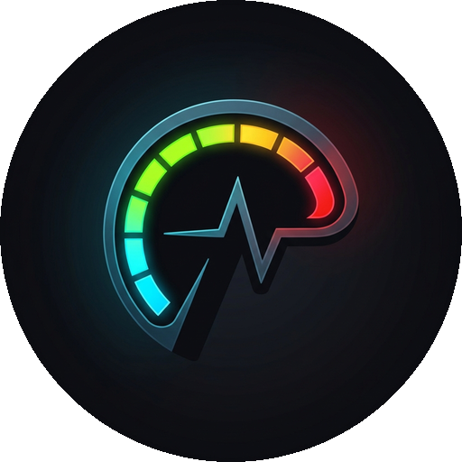

# PulseShift

<p align="center">
  
</p>

**ESP32 motorcycle shift-light and CAN bus acquisition firmware.**

PulseShift turns an ESP32 DevKit V1 into a standalone passive CAN (Controller Area Network) diagnostic logger and progressive shift-light display for motorcycles. It boots directly into one production operating path - listen-only CAN monitoring, the unified RPM decoder, six-LED rendering and flash capture - streams live telemetry over BLE, and is fully configured from the Android app without ever transmitting a single bit onto the motorcycle's network. No PC, USB connection or internet is required after flashing.

> [!IMPORTANT]
> **Real motorcycle CAN communication has already been successfully captured.**
> Session 2 on a **2025 Bajaj Pulsar NS125 ABS** produced **22,542 exported records** across three capture stages, 18 distinct CAN IDs, and approximately 82.5 seconds of data at 500 kbps - with zero corrupt records. A candidate engine-speed signal has been identified but its RPM conversion formula is not yet independently verified. A standalone **provisional RPM LED preview** now follows this estimated value on fresh CAN data (default multiplier 40.0); the fully verified shift-light mode still requires independent tachometer calibration. Preview output must not be mistaken for an accurate riding shift cue.

---

## Table of Contents

1. [Project Status](#1-project-status)
2. [How PulseShift Works](#2-how-pulseshift-works)
3. [Hardware Requirements](#3-hardware-requirements)
4. [Hardware Wiring](#4-hardware-wiring)
5. [Software Installation - Windows](#5-software-installation-windows)
6. [Quick Start - LED Bench Test](#6-quick-start-led-bench-test)
7. [Connecting to the Motorcycle](#7-connecting-to-the-motorcycle)
8. [Capturing CAN Data](#8-capturing-can-data)
9. [Exporting and Preserving Recordings](#9-exporting-and-preserving-recordings)
10. [Monitoring Engine RPM](#10-monitoring-engine-rpm)
11. [RPM Calibration](#11-rpm-calibration)
12. [BLE Monitoring and Configuration](#12-ble-monitoring-and-configuration)
13. [Serial Monitor Command Reference](#13-serial-monitor-command-reference)
14. [Configuration](#14-configuration)
15. [Troubleshooting](#15-troubleshooting)
16. [Firmware Project Structure](#16-firmware-project-structure)
17. [Tests and Verification](#17-tests-and-verification)
18. [Safety and Technical References](#18-safety-and-technical-references)

---

## Compatibility and firmware update policy

**Android and firmware are separate releases.** The Android app may change its screens, presets, labels and layout without reflashing the ESP32 when it continues using the BLE commands and capabilities the installed firmware already supports. The ESP32 operates autonomously after boot, retaining its last successfully saved configuration in NVS. A new application feature that requires a new BLE opcode, effect renderer or firmware behavior still needs a compatible firmware release. See [docs/BLE-PROTOCOL.md](docs/BLE-PROTOCOL.md) for the existing protocol.

**Current default lighting profile:** six LED activation thresholds at **1000, 2000, 3000, 4000, 5000, 6000 RPM**, with the **warning at 6500 RPM**. Those thresholds do **not** cap live RPM telemetry. Effect 5 is a provisional live CAN preview; effect 4 requires verified calibration. Existing devices retain saved NVS settings after firmware updates, so new compiled defaults do not automatically replace a previously saved profile. Shipped Android presets may default to 100% brightness (255/255); this does not silently overwrite existing device brightness.

**Firmware OTA updates are not yet implemented or hardware-validated.** Having an OTA-capable partition layout is not, by itself, a functioning update mechanism. A future release must independently verify installed flash partitions, available image-slot size, power-loss safety, image authenticity, secure authorization, rollback support, and preservation of LittleFS captures and NVS credentials before enabling any update transport. Never assume that an app update can replace firmware. Do not change the partition table or erase flash while valued recordings are present; export and verify them first. Firmware updates and bench tests must be performed with the motorcycle parked and stable power supplied.

> **Release gate:** A firmware build is not field-proven merely because CI passes. Real ESP32 + Android BLE authentication, configuration application, NVS persistence across power cycles, CAN receive-only operation, LED output and recovery behavior still require physical verification before declaring the firmware stable for long-term deployment.

---

## 1. Project Status

| Capability | Status |
|---|---|
| Firmware compilation (single production path) | ✅ Verified - GitHub Actions CI |
| Physical CAN reception on motorcycle | ✅ **Verified** - 2025 Bajaj Pulsar NS125 ABS |
| CAN recording to internal flash | ✅ Verified - 22,542 records, 0 corrupt |
| CAN export via Serial Monitor | ✅ Demonstrated - paginated DUMP workflow |
| CAN capture export over BLE (bounded pages) | ✅ Implemented - host-tested dispatcher, bench BLE validation pending |
| BLE monitoring and streaming (protocol v1) | ✅ Implemented and software-tested; live Android RPM observations reported on the motorcycle |
| BLE configuration and command protocol v2 (2.2.0) | ✅ Implemented and software-tested; complete real-device mutation, save and reconnect validation still required |
| BLE owner enrollment and challenge-response security | ✅ Implemented and software-tested - physical BOOT window required |
| Device commands (restart, reload, clear diagnostics, recording toggle) | ✅ Implemented and host-tested |
| Firmware-driven calibration workflow | ✅ Implemented and host-tested - vehicle validation pending |
| LED bench test (`RPM TEST`) | ✅ Implemented and software-tested |
| Unified LED controller (six WS2812B, no display dependency) | ✅ Implemented - host-tested layer priorities |
| RPM candidate identification (CAN ID `0x301`) | ✅ Observed in real capture data |
| RPM conversion formula (multiplier 40.0) | ⚠️ Provisional - not independently verified |
| Standalone provisional RPM LED preview (effect 5) | 🧪 Implemented - unverified estimate, physical LED test pending |
| Verified RPM shift-light mode (effect 4) | 🔒 Disabled until independent calibration verification |
| Android app | 🔗 Separate workspace (`D:\Development\PulseShift\android`) - compiles and passes unit tests with the 2.2.0 protocol |

**Verified capture details:**

- Vehicle: 2025 Bajaj Pulsar NS125 ABS
- Bitrate: 500 kbps
- Session 2 exported records: 22,542
- Distinct CAN IDs observed: 18
- Duration: approximately 82.5 seconds
- Three capture stages (key-on, idle, gentle RPM sweep)
- Corrupt records: 0 (CRC16 verified)
- Candidate RPM frame: CAN ID `0x301`, payload byte 0 (`data[0]`)
- Provisional multiplier: 40.0 - consistent with idle behavior, **not yet validated**

> [!NOTE]
> Zero corrupt records means every exported frame passed its embedded CRC16 checksum check as transmitted by the ESP32. It does not guarantee that the PC's Serial Monitor buffer retained every line during export, which is why the [paginated export procedure](#9-exporting-and-preserving-recordings) includes independent host-side verification steps.

---

## 2. How PulseShift Works

```text
Motorcycle ECU
      |
   CAN-H / CAN-L  (differential electrical signals, ISO 11898-2)
      |
SN65HVD230 Transceiver  (converts differential voltage to 3.3V digital signal)
      |
ESP32 GPIO16  →  TWAI Controller  (extracts complete CAN frames, listen-only)
      |
      ├── CAN Recording  →  LittleFS flash  (survives power loss)
      |
      ├── Live USB stream  →  Serial Monitor  (optional, STREAM ON)
      |
      ├── Unified RPM Candidate Monitor  →  phone-configurable CAN ID/byte/
      |      byte-width/multiplier (default 0x301, byte 0, x40.0 - provisional)
      |
      ├── BLE GATT Server  →  phone monitoring (v1 telemetry) and
      |      configuration (v2: decoder, LED effects, NVS persistence,
      |      owner enrollment + challenge-response security)
      |
      ├── Persistent Config Manager  →  NVS-backed decoder + LED configuration
      |
      └── Unified LED Controller  →  provisional RPM preview (unverified) /
             verified shift light (requires calibration) / decorative and status LEDs
             →  WS2812B LEDs
```

**CAN - Controller Area Network** is the communication protocol used by the motorcycle's ECU (Engine Control Unit) to broadcast sensor data to the instrument cluster and other modules. All messages travel on two wires: CAN-H (high) and CAN-L (low), which carry complementary voltages.

**TWAI - Two-Wire Automotive Interface** is Espressif's name for the CAN controller built into the ESP32 chip. PulseShift configures it in listen-only mode, so the ESP32 receives frames but never transmits.

**Each CAN frame** has an identifier (CAN ID) and up to 8 payload bytes. The identifier indicates the type of message; the payload carries the actual data. The firmware records every frame with a millisecond timestamp, stage label, and CRC checksum.

**The LED engine** can render a clearly unverified, provisional RPM preview by default, using incoming CAN ID 0x301 byte 0 multiplied by 40.0. The separately selectable verified RPM shift-light mode remains gated by an independent calibration record.

---

## 3. Hardware Requirements

### For CAN capture (minimum required)

| Part | Notes |
|---|---|
| ESP32 DevKit V1 (ESP32-WROOM-32) | 30-pin board; not the WROVER variant |
| USB data cable (micro-USB) | Must be a **data** cable, not a charging-only cable |
| SN65HVD230 3.3V CAN transceiver breakout | Breakout pins labeled `CTX`/`CRX` or `TXD`/`RXD` |
| Short hook-up wires | For bench connections |

### For complete LED shift-light installation

| Part | Notes |
|---|---|
| 6× WS2812B addressable LEDs | 5V, GRB format, 800 kHz - a 6-pixel strip segment |
| 330-470 Ω resistor | Placed in series with the LED data line, close to DIN |
| 1000 µF / 10V electrolytic capacitor | Across LED +5V and GND at the strip |
| Regulated 5V supply, ≥ 1A | Powers LEDs; use a DC-DC buck converter from motorcycle 12V |
| Optional: SN74AHCT125 level shifter | Recommended for vehicle harness runs >20 cm |

> [!NOTE]
> Six WS2812B LEDs at full white (brightness 255) draw approximately 360 mA. Combined with the ESP32 (~90-120 mA) and transceiver (~15 mA), worst-case demand is around 465 mA peak on the 5V rail. A supply rated for at least 1 A is recommended.

---

## 4. Hardware Wiring


### CAN transceiver connections


The table below shows the exact connections used in the physically verified configuration.

| Connection | Detail |
|---|---|
| Motorcycle CAN-H | Breakout `CANH` (Pin 7) |
| Motorcycle CAN-L | Breakout `CANL` (Pin 6) |
| Breakout `CRX` / `RXD` (Pin 4) | ESP32 **GPIO16** |
| Breakout `CTX` / `TXD` (Pin 1) | ESP32 **3V3** directly - **no resistor** |
| ESP32 **GPIO17** | **Physically disconnected** - air gap, no wire |
| Breakout `VCC` (Pin 3) | ESP32 **3V3** |
| Breakout `GND` (Pin 2) | Common circuit ground |
| Breakout `Rs` (Pin 8) | Ground (often hardwired on the PCB already) |
| Breakout `Vref` (Pin 5) | Unconnected (leave open) |

> [!WARNING]
> **CTX connects directly to ESP32 3V3. No 10 kΩ pull-up resistor was used or is needed.** This clamps the transceiver's transmit driver permanently in the recessive (idle) state, preventing the hardware from asserting any dominant bits onto the motorcycle bus. Do not add a resistor here - the direct connection is intentional and was verified working.

> [!WARNING]
> **GPIO17 must remain physically disconnected.** The ESP32's TWAI transmit pin has no wire inserted. Software listen-only mode alone cannot guarantee isolation if a bootloader glitch or firmware misconfiguration occurs. Firmware cannot detect whether a physical wire is present. Inspect the GPIO17 socket visually before every motorcycle connection.

**Why both safeguards matter:**
- `CTX → 3V3`: Hardware clamp - prevents the transceiver IC from ever driving the bus dominant, regardless of software state.
- `GPIO17 air gap`: Physical isolation - eliminates any electrical path between the TWAI TX pin and the transceiver even if the firmware misbehaves during boot.

**CAN-H and CAN-L explained:** The motorcycle ECU communicates on a differential pair. CAN-H is pulled toward ~3.5V during a dominant bit; CAN-L is pulled toward ~1.5V. The difference (~2V) is what the transceiver detects. Neither wire should be connected directly to any supply voltage.

**Termination check:** Many SN65HVD230 breakout boards include an onboard 120 Ω resistor between CANH and CANL. The motorcycle bus is already terminated at both physical ends (total bus impedance 60 Ω). Adding a third 120 Ω terminator drops the bus to 40 Ω and can trigger ECU error warnings. **Measure the resistance across the unpowered breakout's CANH-CANL pins with a multimeter before connecting to the motorcycle.** If the reading is approximately 120 Ω, desolder resistor R2 (or cut its trace jumper). If the reading is open circuit, no modification is needed.

### LED connections


| Connection | Detail |
|---|---|
| ESP32 **GPIO27** → 330-470 Ω resistor → LED strip **DIN** | Data signal - connect resistor close to the DIN terminal |
| Regulated **5V** → LED strip **+5V** | LED power - never use 3.3V |
| Common **GND** → LED strip **GND** | Ground |
| 1000 µF capacitor | Across +5V and GND at the strip entry |
| LED strip **DOUT** (6th LED) | Leave unconnected |

Data flows in one direction, indicated by the arrow printed on the strip. Connect to `DIN` only.

### ESP32 DevKit V1 pin reference


### Power safety


- **Never connect motorcycle 12V directly to the ESP32.** Use an automotive DC-DC buck converter (12V → regulated 5V, minimum 2A, with inline 1A fuse) for in-vehicle installations.
- **Never connect the ESP32 3V3 pin to any external 5V or 12V source.**
- For detailed power architecture and automotive transient protection, see [docs/HARDWARE.md](docs/HARDWARE.md).

---

## 5. Software Installation - Windows

This section walks through every step from a fresh Windows machine to a running PulseShift firmware upload. No command-line tools, Python, or PlatformIO are required.

### Step 1 - Install Arduino IDE

Download **Arduino IDE 2.x** from [arduino.cc/en/software](https://www.arduino.cc/en/software) and run the installer. Accept the default options.

### Step 2 - Add the ESP32 board package URL

1. Open Arduino IDE.
2. Go to **File → Preferences**.
3. Find the **Additional boards manager URLs** field.
4. Add this URL (paste exactly, on its own line if other URLs exist):

```text
https://espressif.github.io/arduino-esp32/package_esp32_index.json
```

5. Click **OK**.

### Step 3 - Install the ESP32 board package

1. Go to **Tools → Board → Boards Manager**.
2. Search for `esp32`.
3. Find **esp32 by Espressif Systems**.
4. Select version **3.3.12** from the version dropdown.
5. Click **Install**. This downloads about 300 MB and may take several minutes.

> [!NOTE]
> If you do not see version 3.3.12 listed, click the boards manager refresh button or check your internet connection. Older versions are listed below the latest; scroll the dropdown to find 3.3.12.

### Step 4 - Install required libraries

Go to **Tools → Manage Libraries** and install each of the following by searching the exact name shown:

| Library | Minimum version |
|---|---|
| **Adafruit NeoPixel** | 1.12.3 |
| **NimBLE-Arduino** | 2.3.8 |

Click **Install** for each. If prompted to install dependencies, choose **Install all**.

### Step 5 - Download PulseShift

Either:
- **Clone:** `git clone https://github.com/iamaritrasaha/PulseShift.git PulseShift-Firmware`
- **Download ZIP:** Click **Code → Download ZIP** on GitHub, then extract the archive.

### Step 6 - Open the sketch

In Arduino IDE, go to **File → Open** and navigate to `PulseShift-Firmware/PulseShift/PulseShift.ino`. Open that file.

> [!IMPORTANT]
> Open `PulseShift.ino` specifically - not the folder. Arduino IDE must open the `.ino` file directly so it recognizes the full sketch with all source files in `src/`.

### Step 7 - Connect the ESP32

Plug the ESP32 DevKit V1 into your PC using a **USB data cable**. The board has a power LED that should light up immediately.

**If no COM port appears:**
- Try a different USB cable - many cheap cables are charge-only and have no data wires.
- Check Device Manager (search "Device Manager" in Windows Start). Look under **Ports (COM & LPT)** for a CP210x or CH340 device.
- If nothing appears, install the CP2102 driver from [silabs.com/developers/usb-to-uart-bridge-vcp-drivers](https://www.silabs.com/developers/usb-to-uart-bridge-vcp-drivers) or the CH340 driver from your board supplier.

### Step 8 - Select board and configure settings

Go to **Tools** and set each option:

| Setting | Value |
|---|---|
| **Board** | ESP32 Dev Module |
| **Upload Speed** | 921600 |
| **Flash Size** | 4MB (32Mb) |
| **Partition Scheme** | Default 4MB with spiffs |
| **PSRAM** | Disabled |
| **Port** | Your ESP32 COM port (e.g. COM3) |

> [!IMPORTANT]
> The **"Default 4MB with spiffs"** partition scheme is required. It creates the LittleFS flash partition that PulseShift uses to record and preserve CAN data. Without it, flash recording will fail on first boot.

> [!WARNING]
> If your ESP32 already contains a valuable CAN recording from a motorcycle session, **do not upload new firmware or change the partition scheme** without first exporting the data using the `DUMP` command. Uploading new firmware does not automatically erase flash recordings, but changing the partition scheme may format the entire flash. See [Section 9](#9-exporting-and-preserving-recordings) first.

### Step 9 - Compile the firmware

Click the **✓ (Verify)** button in the toolbar, or press **Ctrl+R**. This compiles the firmware without uploading it. All files should compile without errors in roughly 10-60 seconds.

**If compilation fails with "library not found":** Return to Step 4 and confirm the library was installed under the exact name shown.

### Step 10 - Upload the firmware

Click the **→ (Upload)** button, or press **Ctrl+U**.

If the upload fails with "Failed to connect to ESP32":
1. Hold the **BOOT** button on the ESP32 board.
2. Click **Upload** in Arduino IDE.
3. Release **BOOT** when "Connecting…" appears in the console.

> [!NOTE]
> This manual BOOT button hold is only needed on some older ESP32 DevKit boards. Most modern boards enter upload mode automatically.

### Step 11 - Open Serial Monitor

Go to **Tools → Serial Monitor** (or press **Ctrl+Shift+M**).

Set the baud rate dropdown to **115200 baud** and the line-ending dropdown to **Both NL & CR**.

You should see startup messages similar to:

```text
PulseShift mode=CAN_CAPTURE SDK=v5.x.x
[STORAGE] LittleFS mounted: 0 / 1032192 bytes used (1032192 free)
TARGET: NS125 ABS 2025 / SN65HVD230 / 6 WS2812B LEDs
RECEIVE ONLY: Breakout CTX tied to 3V3 directly, GPIO17 disconnected, software listen-only
CAN_CAPTURE: raw frames and offline diagnostics active
[LIVE] Bus: OK (500000 bps) | Traffic: WAITING | Stage 1 (KEY_ON_ENGINE_OFF) | Rec: 0 | Flash: 1032192 B
```

If the Serial Monitor is blank, check that the baud rate is set to 115200 and that you have selected the correct COM port under **Tools → Port**.

---

## 6. Quick Start - LED Bench Test

### Standalone provisional RPM preview (no phone or PC after flashing)

On a fresh configuration, firmware starts in **effect 5: provisional RPM preview**.
The ESP32 directly decodes motorcycle CAN ID `0x301`, byte 0, with the
unverified formula `RPM ~= raw * 40.0`, and renders the six saved thresholds
(default 1000, 2000, 3000, 4000, 5000, 6000 RPM; warning at 6500).
At a fresh estimated 1400-1600 RPM, the first RPM LED should be active with the default thresholds. As the raw value increases, the bar advances. This is a provisional display, not a verified tachometer. The independent calibrated RPM mode
(effect 4) still needs reference measurement and an explicit calibration record.

Neither Android nor USB is needed at runtime once firmware is flashed and
ESP32/LEDs receive **proper regulated 5V power**. Connecting CAN-H/CAN-L/GND
alone does not supply power.

This mode uses real incoming CAN data; it is not a simulator and does not
transmit onto the motorcycle CAN bus. It has no stationary-only or arbitrary
throttle lock. It **does** blank on missing, stale or invalid candidate
samples, and maintains CAN receive-only protections and fault indication.
**Do not use the provisional values as a trusted riding shift cue until
cross-checked with an independent tachometer.**

**Existing NVS configuration:** A saved decorative effect from an older
firmware remains selected on upgrade. A one-time `CONFIG RESET` over Serial,
or setting effect 5 via a compatible authenticated BLE client and saving,
selects the new default. `CONFIG RESET` restores lighting and decoder
defaults, leaves previously captured CAN data untouched, and preserves
enrolled owner credentials.


You can test the LED shift-light display on your desk without connecting to any motorcycle. This verifies that the LEDs, wiring, and firmware are all working correctly.

### What you need

- ESP32 with PulseShift firmware uploaded
- 6× WS2812B LED strip connected to GPIO27 via a 330-470 Ω resistor
- 5V power supply for the LEDs

### Running the bench test

1. Open **Serial Monitor** at 115200 baud.
2. Type the following command and press **Enter** (or click **Send**):

```text
RPM TEST 4500
```

**Expected result:** The firmware acknowledges the test and illuminates four LEDs (LEDs 1-4) in a progressive green-to-orange pattern. The Serial Monitor shows:

```text
[TEST] 6-LED shift-light bench test active: 4500 RPM for 10s (Verified RPM mode requires calibration; provisional preview is separate)
```

The test automatically ends after **10 seconds** and the LEDs return to their CAN capture status display. You can also end it immediately:

```text
RPM TEST OFF
```

**Expected output:**
```text
[TEST] Shift-light bench test disabled. Returned to field capture status LEDs.
```

Try different values to see the full LED progression:

| Command | LEDs lit | Effect |
|---|---|---|
| `RPM TEST 1000` | 1 | Green |
| `RPM TEST 3000` | 1-3 | Green |
| `RPM TEST 5000` | 1-5 | Green through orange |
| `RPM TEST 6000` | All 6 | All six threshold LEDs active (warning begins at 6500) |
| `RPM TEST 6500` | All 6 / warning overlay | Flashing red warning with default warning pattern |

> [!NOTE]
> `RPM TEST` only controls the LEDs - it does not inject fake CAN frames or affect the recording. CAN recording continues normally in the background. The notice indicates that the **verified RPM mode** remains gated; the separate provisional CAN preview is allowed to show a live unverified estimate.

The production firmware does not include a Demo or synthetic ECU mode. Do not attempt to enable it.

---

## 7. Connecting to the Motorcycle

> [!WARNING]
> Read this section completely before connecting anything to a powered motorcycle.

### Pre-connection checklist

Before connecting to the motorcycle, verify the following by physical inspection:

1. ☐ **GPIO17 air gap**: No wire is inserted into the ESP32 GPIO17 pin socket.
2. ☐ **CTX → 3V3 direct**: The transceiver `CTX`/`TXD` pin connects directly to ESP32 3V3. No resistor in this connection.
3. ☐ **CRX → GPIO16**: The transceiver `CRX`/`RXD` pin connects to ESP32 GPIO16.
4. ☐ **Transceiver VCC**: Connects to ESP32 3V3 - not 5V or any motorcycle power.
5. ☐ **Common ground**: ESP32 GND, transceiver GND, and motorcycle signal GND are all connected.
6. ☐ **Termination resistor verified**: You have measured CANH-CANL resistance on the unpowered breakout. If it reads ~120 Ω, you have desoldered R2. If open circuit, no action needed.

### Finding the motorcycle's CAN connector

The 2025 Bajaj Pulsar NS125 ABS provides a diagnostic connector. Use a multimeter in DC voltage mode (key ON, engine OFF) to identify the CAN-H and CAN-L wires:
- **CAN-H**: Approximately 2.5-3.0V measured to chassis ground.
- **CAN-L**: Approximately 2.0-2.5V measured to chassis ground.

> [!IMPORTANT]
> Do not rely solely on wire color to identify CAN lines. Colors vary between production batches and harness revisions. Always verify with a multimeter. Do not assume that the pinout shown for one model applies to another model or year.

### Power and ground during investigation

**Use a laptop running on internal battery** (unplugged from AC mains) when capturing data with the ESP32 connected to the motorcycle. Connecting an AC-earthed desktop PC to the motorcycle creates ground loops through the USB cable that can damage the PC motherboard, the ESP32, or the motorcycle ECU.

The ESP32 and transceiver are powered by the laptop's USB 5V bus during investigation. **Do not connect the motorcycle's 12V or the LED strip's 5V buck converter to the ESP32 VIN pin while USB is connected.**

For extended CAN capture without a laptop, power the ESP32 from a regulated 5V source derived from the motorcycle's switched ignition (12V → 5V buck converter with inline 1A fuse). Connect CAN-H and CAN-L to the transceiver. Data is recorded automatically to flash without USB.

For detailed electrical safety rules and automotive protection, see [docs/HARDWARE.md](docs/HARDWARE.md).

---

## 8. Capturing CAN Data

PulseShift records CAN frames automatically from boot. Stages label your recording so you can later correlate frames with specific motorcycle conditions.

### Starting a capture session

1. Connect the hardware and power up (or plug in USB).
2. Open **Serial Monitor** at 115200 baud.
3. Turn the motorcycle ignition **ON** (engine still off at this point).
4. The firmware will show CAN traffic arriving within seconds:

```text
[CAN] First motorcycle CAN frame received! Traffic is active.
[LIVE] Bus: OK | Traffic: ACTIVE | Stage 1 (KEY_ON_ENGINE_OFF) | RX: 142 | Rec: 142 | Drops: 0 | Flash: 1024 B
```

### Stage commands

Stages label blocks of your recording for later analysis. They do not start or stop recording - that happens automatically.

**Stage 1 - Ignition ON, engine OFF**

This is the default stage at boot. No command is needed if you turn the ignition on before powering the ESP32. To set it explicitly:

```text
STAGE 1
```

Captures: instrument cluster wake-up messages, sensor baseline values, and any ECU initialization frames.

**Stage 2 - Warm engine idle**

Start the motorcycle engine and let it settle at idle (~1,300-1,500 RPM). Then type:

```text
STAGE 2
```

Captures: steady-state ECU messages at idle. The LED strip shows amber indicators for the active stage.

**Stage 3 - Gentle, controlled RPM changes**

With the motorcycle stationary in neutral, gently apply and release the throttle. Then type:

```text
STAGE 3
```

Captures: dynamic RPM transitions that allow identification and calibration of engine-speed CAN signals.

> [!IMPORTANT]
> Stage 3 RPM sweeps must be performed with the motorcycle **stationary, in neutral, on a center stand, with adequate ventilation**. Never attempt controlled RPM sweeps while riding.

You can also cycle stages using the ESP32's physical **BOOT button** (short press advances the stage). A long press (>1.5s) pauses or resumes recording.

### Useful monitoring commands

| Command | What it does |
|---|---|
| `STATUS` | Full system snapshot: CAN health, storage, RPM candidate |
| `STREAM ON` | Enables live raw CAN frame output in Serial Monitor |
| `STREAM OFF` | Returns to concise 2-second summary mode (default) |
| `CAPTURE STOP` | Flushes buffers and pauses recording |
| `CAPTURE RESUME` | Resumes recording |

**Live stream format** (when `STREAM ON` is active):

```text
FRAME,10452,2,00000301,0,0,8,2600000000000000
```

Fields: `timestamp_ms`, `stage`, `can_id`, `extended`, `rtr`, `dlc`, `payload_hex`

> [!NOTE]
> `STREAM ON` outputs one line per received CAN frame. At 500 kbps with 18 active IDs, this can be hundreds of lines per second and may cause Serial Monitor lag. Use it for short diagnostic bursts only. For large recordings, the default 2-second summary mode is recommended.

### What is stored

Every received CAN frame is saved to LittleFS flash (a filesystem stored in the ESP32's internal flash memory) with:
- Millisecond timestamp from ESP32 boot
- CAN ID, extended flag, RTR flag, DLC (Data Length Code), and 8 payload bytes
- Stage label (1, 2, or 3)
- CRC16 checksum

**Recordings survive power loss.** When you disconnect the ESP32 from the motorcycle and reconnect via USB, the firmware automatically detects and preserves the previous session. It will not start overwriting until you explicitly clear storage with `CLEAR YES`.

**Storage capacity:** Up to approximately 50,000 frames (~1 MB). At 150 frames/second, this is roughly 5-6 minutes of continuous capture.

---

## 9. Exporting and Preserving Recordings

Recorded frames are exported as CSV text through the Serial Monitor. The process is paginated in 500-record blocks to prevent the PC's Serial Monitor scroll buffer from overflowing on large captures.

### Export commands

| Command | What it does |
|---|---|
| `DUMP` | Export the first (or next) 500-record page |
| `DUMP NEXT` | Equivalent to `DUMP` - advances to the next page |
| `DUMP PAGE 2` | Export a specific page number directly |
| `DUMP STATUS` | Show current export cursor position and total pages |
| `DUMP CANCEL` | Reset export cursor back to page 1 |
| `DUMP ALL` | Export every record in a single uninterrupted stream |

### Paginated export procedure

1. Type `DUMP` and press Enter.
2. Wait for the page to finish. You will see:

```text
=== BEGIN PULSESHIFT RAW CAN CAPTURE [PAGE 1/46: RECORDS 1-500 OF 22542] ===
[HEADER] magic=PULSECAP ver=1 recSize=20 sess=2 boot=1 bitrate=500000 startMs=1200 mode=CAN_CAPTURE vehicle=NS125 ABS 2025
timestamp_ms,can_id,extended,rtr,dlc,data,stage,crc_ok
1205,00000120,0,0,8,0102030405060708,1,1
1208,00000301,0,0,8,2600000000000000,1,1
...
=== END PULSESHIFT PAGE 1/46 (RECORDS 1-500 OF 22542) [Next: 'DUMP NEXT' or 'DUMP ALL'] ===
```

3. Click the **Copy Output** button in the top-right corner of the Serial Monitor tab.
4. Open **Windows Notepad**, paste (Ctrl+V), and save as `capture_page1.txt`.
5. Type `DUMP NEXT` and repeat for each page.

> [!WARNING]
> Do not use Ctrl+A to select text in Arduino IDE 2.x Serial Monitor. It may fail to select lines outside the visible scroll area. Always use the dedicated **Copy Output** button.

### Verifying export completeness

After saving all pages, verify the export:

**Check 1 - Page boundaries:** Confirm every page from 1 to N is present with contiguous record numbers. The final page shows the total summary:

```text
=== END PULSESHIFT RAW CAN CAPTURE expected=22542 exported=22542 valid=22542 corrupt=0 totalBytes=450840 ===
```

**Check 2 - Row count:** Count actual CSV data rows in PowerShell:

```powershell
(Get-Content capture.csv | Where-Object { $_ -match "^\d+," }).Count
```

Confirm the count matches `expected` in the final summary line.

**Check 3 - CRC column:** Every data row ends with `,1` in the `crc_ok` column. Any `,0` indicates a corrupt record.

> [!NOTE]
> The `expected=N exported=M` counters confirm what the ESP32 transmitted. They cannot confirm what the PC's Serial Monitor retained in its scroll buffer. This is why page-by-page copy is recommended for captures over ~5,000 records.

### Erasing recordings (destructive)

> [!CAUTION]
> `CLEAR YES` permanently deletes all stored CAN frames and diagnostic logs. This action cannot be undone. Only run it after you have fully exported and verified your data.

```text
CLEAR
```

The firmware will respond with a warning and ask you to confirm. Then type:

```text
CLEAR YES
```

A fresh recording session begins immediately. The session ID increments so you can distinguish sessions in exported data.

---

## 10. Monitoring Engine RPM

The firmware continuously monitors CAN ID `0x301` as a candidate engine-speed signal identified in the Session 2 real capture data.

### RPM monitoring commands

```text
RPM STATUS
```

Prints a snapshot of the current candidate signal:

```text
=== PulseShift Candidate RPM Monitor ===
Candidate CAN ID : 0x301
Byte Index       : 0
Raw Value        : 38
Estimated RPM    : 1520
Multiplier       : 40.0
Signal Fresh     : YES
Last Update      : 42 ms ago
Calibration      : UNVERIFIED
Verified LED Mode: CALIBRATION REQUIRED
CAN TX           : SOFTWARE MUTED (Verify CTX->3V3 & GPIO17 air-gap)

--- Candidate Diagnostics ---
Frames Received  : 1840
Frames Rejected  : 0
Observed Range   : Min: 0 | Max: 240
Freshness Window : 250 ms (~10-12 frames at 45 Hz)
```

```text
RPM MONITOR ON
```

Starts a 10 Hz (100 ms interval) live stream:

```text
CAND,15420,0x301,38,1520,1
CAND,15520,0x301,37,1480,1
CAND,15620,0x301,39,1560,1
```

Fields: `CAND`, `timestamp_ms`, `candidate_id`, `raw_byte0`, `estimated_rpm`, `signal_fresh`

```text
RPM MONITOR OFF
```

Stops the live stream.

### How the estimate is calculated

```text
Raw value from data[0]: 38
Provisional multiplier: 40.0
Estimated RPM: 38 × 40.0 = 1520
```

The multiplier was chosen because it places warm idle readings (raw ~35-40) in the range 1,400-1,600 RPM, consistent with the Bajaj owner manual's idle speed specification. However, the owner manual specification is a general guide, not a measurement from this specific motorcycle. The result remains a **candidate estimate**, not a verified engine speed reading.

### Observed behavior in real capture data

| Condition | CAN ID `0x301` data[0] raw value |
|---|---|
| Stage 1 - Ignition ON, engine OFF | Constant 0 |
| Stage 2 - Warm idle | Settles to 35-40 (median ~37) after transient |
| Stage 3 - Gentle throttle sweeps | Rises smoothly to ~240, falls back to idle, then 0 |

The range (0 to 240) and the smooth, continuous response to throttle changes are consistent with an engine speed signal. However, until the formula is validated against an independent instrument, the values must be treated as provisional.

### Adjusting the multiplier

```text
RPM MULTIPLIER 42.0
```

Updates the provisional multiplier in the authoritative active configuration and live decoder. Range: 0.1 to 1000.0. Calibration status remains `UNVERIFIED`. This command changes the current session only; use `CONFIG SAVE` to persist the value across ESP32 reboots. It does not enable verified shift lights.

```text
[RPM] Multiplier 42.000 applied (UNVERIFIED; type CONFIG SAVE to persist)
```

---

## 11. RPM Calibration

Before the **verified RPM shift-light mode** can be enabled, the RPM conversion formula must be checked against an independent reference measurement. The optional provisional preview works without that verification, but remains explicitly UNVERIFIED.

> [!IMPORTANT]
> Using only the owner manual idle speed specification as the reference is insufficient. Owner manual values are nominal targets, not measurements from your specific motorcycle. Calibration requires simultaneous readings from both the ESP32 and an independent instrument at multiple, distinctly different RPM values.

### What you need

- Motorcycle stationary, in neutral, on center stand, with adequate ventilation
- ESP32 connected in passive listen-only mode, running `RPM MONITOR ON`
- **Independent RPM reference**: OBD-II scan tool displaying live engine speed, or an optical/inductive workshop tachometer pointed at the engine

### Two-point calibration procedure

**Sample point 1 - Warm idle:**
1. Run the engine at operating temperature until idle is completely stable.
2. Simultaneously note the raw value from `RPM STATUS` and the reference instrument reading.
3. Record the pair: e.g. `(raw=37, ref_rpm=1450)`.

**Sample point 2 - Moderate steady hold:**
1. With the motorcycle stationary in neutral, hold the throttle steady at approximately 3,000-4,000 RPM.
2. Wait for the reading to stabilize (a few seconds).
3. Record the pair simultaneously: e.g. `(raw=75, ref_rpm=3050)`.

**Computing the linear formula:**

Using the two pairs $(x_1, y_1)$ and $(x_2, y_2)$:

$$m = \frac{y_2 - y_1}{x_2 - x_1} = \frac{3050 - 1450}{75 - 37} = \frac{1600}{38} \approx 42.1$$

$$c = y_1 - m \cdot x_1 = 1450 - 42.1 \times 37 \approx -108$$

The resulting formula is: `RPM = raw × 42.1 − 108`

**Validation:** Take at least one additional measurement at a different RPM and verify that the formula predicts it correctly within a reasonable tolerance. If the prediction is significantly off, collect more reference points.

**Enabling shift lights:** No recompile is involved. The Android app drives the firmware calibration session (RPM & Calibration screen, Advanced tab): it captures 2-second raw samples at 3+ operating points spanning at least 1,500 RPM against a trustworthy independent tachometer reference, the ESP32 fits and validates scale/offset on-device (monotonic evidence, <= 150 RPM residual), and only then binds a verification record to the exact decoder fingerprint. Physical six-stage RPM bar lighting activates automatically once that record is bound; any decoder change unbinds it and blanks the bar until recalibration.

Do not enable shift lights based on a single RPM reference point or a theoretical calculation alone.

---

## 12. BLE Monitoring and Configuration

The firmware's [Android BLE Terminal implementation contract](docs/ANDROID-TERMINAL.md) documents the planned Material 3 command console in the separate native Android app. The app-side terminal still needs to be implemented in that local project.


The firmware runs a BLE GATT server (NimBLE stack) alongside the USB serial interface. It provides two versioned phone-facing protocols; both are documented in detail in [docs/BLE-PROTOCOL.md](docs/BLE-PROTOCOL.md).

| Protocol | Purpose | Compatibility |
|---|---|---|
| **v1 telemetry** | Live RPM notifications, health/diagnostic notifications, historical log retrieval, CAN capture page streaming | Retained unchanged; v2 clients and the original Android v1 client both work against current firmware |
| **v2 configuration** | Decoder reconfiguration (CAN ID, byte offset/width/order, multiplier, offset, validity clamp), LED effects and thresholds, mobile-assisted calibration, NVS persistence | Version-checked per command; mismatched versions are rejected with `BLE_CFG_STATUS_VERSION_MISMATCH` |

### Security model

- **Owner enrollment** requires a physically opened authorization window: press the BOOT button (or send `AUTH` over USB) and complete enrollment within the window. Arbitrary token submissions outside the window are rejected with `BLE_CFG_STATUS_UNAUTHORIZED`.
- **Challenge-response authentication**: the phone requests a nonce, then proves possession of the owner secret. Sessions are bound to the BLE connection id and expire on inactivity.
- **Calibration commit is a privileged operation**: writing a verified RPM conversion (which enables RPM-driven shift lights) requires an authorized session.

### Safety notes

- BLE operates only as a peripheral advertising to the paired owner; it never gates CAN recording. Capture continues with or without a phone connected.
- All BLE-facing RPM values still carry the `UNVERIFIED` calibration marker until the calibration workflow binds a verification record.
- Verified RPM shift-light mode (effect 4) remains firmware-blocked for any unverified configuration. Provisional preview (effect 5) is separate and follows live candidate data without marking calibration verified.

> [!NOTE]
> BLE behavior described here is software-tested (unit tests plus scripted live-BLE verification harnesses in `scratch/`). It has not been validated against a production Android build on a motorcycle.

### Mobile-assisted calibration

The v2 protocol implements the [RPM Calibration](#11-rpm-calibration) workflow end to end: the phone reads live raw candidate samples over BLE, captures synchronized reference-tachometer points, fits `RPM = raw × multiplier + offset`, and commits the verified decoder. Verified RPM mode (effect 4) unlocks only after that commit. Before verification, effect 5 can display a provisional RPM preview, while effect 4 remains safeguarded and blank on invalid or unverified data.

---

## 13. Serial Monitor Command Reference

All commands are entered in the Arduino IDE Serial Monitor at **115200 baud**. Commands are case-insensitive. Set line ending to **Both NL & CR**.

| Command | Description |
|---|---|
| `HELP` | Display all available commands |
| `STATUS` | Full system status: CAN health, storage, RPM candidate, diagnostics |
| `LOGS` | Dump the persistent diagnostic event log from flash |
| `RPM STATUS` | Candidate 0x301 snapshot: raw value, estimated RPM, freshness, range |
| `RPM MONITOR` | Print one instantaneous candidate telemetry line |
| `RPM MONITOR ON` | Enable 10 Hz live candidate stream |
| `RPM MONITOR OFF` | Disable live candidate stream |
| `RPM MULTIPLIER <value>` | Update provisional multiplier (range 0.01-1000.0) |
| `RPM TEST <value>` | Bench-test LEDs with simulated RPM for 10 seconds (0-20000) |
| `RPM TEST OFF` | Immediately end shift-light bench test |
| `BLE STATUS` | BLE GATT server status: connection, subscriptions, notify counters |
| `CONFIG STATUS` | Active decoder/LED configuration: revision, fingerprint, calibration status |
| `CONFIG RESET` | Reset configuration to safe defaults (invalidates calibration) |
| `AUTH` / `AUTH ON` | Open the physical BOOT authorization window (owner commissioning) |
| `AUTH OFF` | Close the authorization window early |
| `STAGE 1` | Set recording stage to 1 - Key ON, Engine OFF |
| `STAGE 2` | Set recording stage to 2 - Engine Idling |
| `STAGE 3` | Set recording stage to 3 - Gentle RPM Sweeps |
| `1` / `2` / `3` | Shorthand stage shortcuts - same as `STAGE 1/2/3` |
| `CAPTURE STOP` | Flush in-memory buffers and pause flash recording |
| `CAPTURE RESUME` | Resume flash recording |
| `STREAM ON` | Enable live raw CAN frame streaming |
| `STREAM OFF` | Disable live streaming (default: 2-second summary mode) |
| `DUMP` | Export next 500-record page of stored CAN frames |
| `DUMP NEXT` | Equivalent to `DUMP` |
| `DUMP PAGE <n>` | Export a specific page number |
| `DUMP STATUS` | Show export cursor position and total page count |
| `DUMP CANCEL` | Reset export cursor to page 1 |
| `DUMP ALL` | Export all records in one uninterrupted stream |
| `CLEAR` | Show warning and ask for confirmation before erasing |
| `CLEAR YES` | **⚠️ Destructive** - permanently erase all recordings and reinitialize |

> [!CAUTION]
> `CLEAR YES` is irreversible. It permanently erases all stored CAN capture data and diagnostic logs. Only use it after successfully exporting and verifying your recordings.

> [!NOTE]
> The Android app is the complete command interface: all lighting, decoder, calibration, capture and diagnostics commands work over BLE with firmware acknowledgement and readback. The serial console below is an optional bench convenience.

---

## 14. Configuration

`PulseShift/UserConfig.h` only holds hardware-level compile-time settings. All user-facing lighting, threshold, decoder and calibration settings live in NVS and are edited from the Android app over BLE; no recompile is needed to change them. There is a single production operating path: passive CAN monitoring, the unified RPM decoder, LED rendering and BLE run always, and flash capture is a runtime-toggleable subsystem (BOOT button, serial or BLE command).

### LED settings

| Setting | Default | Description |
|---|---|---|
| `PULSESHIFT_LED_DATA_GPIO` | `27` | ESP32 GPIO connected to LED DIN via 330-470 Ω resistor |
| `PULSESHIFT_LED_COUNT` | `6` | Number of addressable pixels (1-6; the six-stage shift-light engine renders six stages) |

### CAN hardware settings

| Setting | Default | Notes |
|---|---|---|
| `PULSESHIFT_CAN_RX_GPIO` | `16` | ESP32 GPIO connected to breakout CRX/RXD |
| `PULSESHIFT_CAN_TX_GPIO` | `17` | Reserved - must remain physically disconnected |
| `PULSESHIFT_CAN_BITRATE` | `500000` | 500 kbps - do not change without verifying motorcycle bitrate |

> [!WARNING]
> `PULSESHIFT_CAN_RX_GPIO` and `PULSESHIFT_CAN_TX_GPIO` are hardware-critical. Changing GPIO numbers without updating your physical wiring will prevent CAN reception. `PULSESHIFT_CAN_BITRATE` must match the motorcycle's actual CAN bitrate exactly (the NS125 ABS uses 500,000 bps).

### Serial, storage and BLE settings

| Setting | Default | Description |
|---|---|---|
| `PULSESHIFT_SERIAL_DIAGNOSTICS` | `1` | `0` silences the serial console for fully headless operation (BLE stays the command interface) |
| `PULSESHIFT_SERIAL_BAUD` | `115200` | Match this in Arduino IDE Serial Monitor |
| `PULSESHIFT_BOOT_BUTTON_GPIO` | `0` | BOOT button GPIO - short press cycles stages, long press toggles recording, any press opens the owner enrollment window |
| `PULSESHIFT_MAX_CAPTURE_BYTES` | `1000000` | Maximum capture file size in bytes (~50,000 frames) |
| `PULSESHIFT_MAX_DIAG_LOG_BYTES` | `131072` | Maximum diagnostic event log size |
| `PULSESHIFT_BLE_ENABLED` | `1` | BLE GATT peripheral for Android telemetry, configuration and diagnostics |

---

## 15. Troubleshooting

| Problem | Likely cause | Action |
|---|---|---|
| ESP32 not detected (no COM port) | Charge-only USB cable | Replace with a data-capable USB cable |
| ESP32 not detected (no COM port) | Missing USB-UART driver | Install CP2102 or CH340 driver |
| Upload fails "Failed to connect" | Board needs manual BOOT | Hold BOOT button during upload until "Connecting…" appears |
| Firmware does not compile | Library not installed | Re-check Step 4; verify exact library name and version |
| Firmware does not compile | Wrong ESP32 core version | Confirm version 3.3.12 is selected in Boards Manager |
| Serial Monitor blank | Wrong baud rate | Confirm 115200 baud selected in Serial Monitor |
| No CAN traffic (`Traffic: WAITING`) | Ignition is off | Turn motorcycle ignition ON |
| No CAN traffic | CAN-H / CAN-L reversed | Swap the two wires and test again |
| No CAN traffic | Transceiver VCC missing | Verify breakout VCC connects to ESP32 3V3 |
| No CAN traffic | Bitrate mismatch | Confirm `PULSESHIFT_CAN_BITRATE` matches motorcycle |
| CAN controller fault (red LED flashing) | Transceiver wiring error | Check CTX→3V3 connection and common ground |
| CAN queue overflows / dropped frames | High-traffic bus | Non-fatal; reception continues. Check `STATUS` for `missed` and `overrun` counts |
| RPM always zero | No 0x301 frames | Run `STREAM ON` and check whether 0x301 appears |
| RPM estimate stale | Signal freshness timeout (250 ms) | Verify motorcycle engine is running and CAN is active |
| LED strip not lighting | 5V power disconnected | Check LED strip +5V supply |
| LED strip flickering | Data signal too weak | Add or verify 330-470 Ω series resistor on data line |
| LittleFS mount failed | Unformatted flash | Type `CLEAR YES` to format for first use |
| Preserved capture at boot | Prior session detected | Type `DUMP` to export before clearing |
| Storage full | 1 MB quota reached | Type `DUMP` to export, then `CLEAR YES` to wipe |
| Incomplete dump export | Serial Monitor scroll buffer overflow | Use paginated `DUMP` / `DUMP NEXT`; copy each page separately |

---

## 16. Firmware Project Structure

```text
PulseShift-Firmware/
├── PulseShift/                   ← Open PulseShift.ino here in Arduino IDE
│   ├── PulseShift.ino            ← Sketch entry point (setup, loop, serial commands)
│   ├── UserConfig.h              ← Edit this to change settings before uploading
│   └── src/
│       ├── can_transport.*       ← TWAI driver wrapper (listen-only hardware interface)
│       ├── can_recorder.*        ← CAN capture to LittleFS flash with CRC16 and paging
│       ├── rpm_candidate.*       ← Unified phone-configurable candidate RPM decoder/state holder
│       ├── ble_manager.*         ← BLE GATT server: v1 telemetry + v2 configuration/commands
│       ├── ble_protocol.h        ← Versioned BLE packet layouts and opcodes
│       ├── config_manager.*      ← NVS-backed configuration, security and calibration
│       ├── led_controller.*      ← Sole owner of the six WS2812B pixels (no display dependency)
│       ├── led_effects.*         ← Unified priority LED engine (safeguard, effects, RPM bar)
│       ├── led_color.h           ← Shared RGB color primitives
│       ├── storage_manager.*     ← LittleFS mount, session tracking, safe formatting
│       ├── diag_logger.*         ← Persistent diagnostic event log to flash
│       ├── button_handler.h      ← BOOT button stage/recording control
│       ├── serial_protocol.h     ← Serial command parser
│       └── config.h              ← Internal compiled-in constants
├── assets/readme/                ← SVG circuit and wiring diagrams
│   ├── generate.py               ← Standard-library Python script that regenerates all SVGs
│   ├── pulseshift-wiring.svg
│   ├── esp32-pinout.svg
│   ├── ws2812b-circuit.svg
│   ├── sn65hvd230-circuit.svg
│   └── ...
├── scratch/                      ← Physical flash extraction backups and live BLE verification scripts
├── test/                         ← Host-side C++ and Python regression tests
├── tools/                        ← Optional capture utilities (pulseshift_capture.py)
├── docs/                         ← Extended reference documentation
│   ├── BLE-PROTOCOL.md           ← BLE v1 telemetry + v2 configuration/command protocol reference (2.2.0)
│   ├── HARDWARE.md               ← Detailed electrical specs and automotive protection
│   ├── TESTING.md                ← Test suite and verification procedure
│   └── CAN-INVESTIGATION.md      ← Historical TWAI simulator investigation
└── README.md
```

---

## 17. Tests and Verification

### GitHub Actions CI

Every push and pull request to `main` automatically runs compilation checks:

[](https://github.com/iamaritrasaha/PulseShift/actions/workflows/ci.yml)

The CI pipeline (`.github/workflows/ci.yml`) verifies:
- Production firmware compiles cleanly with esp32:esp32 core 3.3.12
- Fully headless variant (serial diagnostics off) compiles cleanly
- Invalid `UserConfig.h` settings trigger compile-time errors
- No OLED dependency (SSD1306/GFX) is referenced anywhere in the sources or CI

A passing CI build confirms that the sketch compiles correctly on a clean machine. It does not replace motorcycle testing, hardware wiring verification, or RPM calibration.

### Host-side unit tests

```bash
bash test/run.sh
```

The host-side test suite (run on Ubuntu in CI) validates:
- Configuration state machine: validation rules, snapshot TLV serialization with CRC32
- Firmware-driven calibration session: point capture, monotonicity/span/residual rejection, fingerprint-bound verification
- Unified LED engine: layer priorities, RPM validity safeguard, per-LED hysteresis, warning patterns, direction and brightness
- BLE v2 command dispatch through the real dispatcher: authorization binding, staged transactions, calibration workflow, device commands, diagnostics TLV blob
- Unified RPM candidate monitor bounds, staleness, 32-bit timer rollover
- CAN transport: listen-only install, TX-pin isolation routing, overflow handling, bounded logging
- RPM serial diagnostics output regression (present when enabled, silent when disabled)
- Binary capture format (76-byte header, 20-byte records) and CRC16-CCITT integrity (offline)
- BLE v1 protocol framing and BLE v2 configuration command handling (Python, 88 tests)
- Production integrity: no OLED/demo/simulation symbols remain, single passive CAN path, bounded command queues, restore-defaults preserves credentials

### Physical verification

| Test | Result |
|---|---|
| CAN reception from motorcycle | ✅ Verified - 2025 Bajaj Pulsar NS125 ABS, 500 kbps |
| CAN recording to LittleFS | ✅ Verified - 22,542 records, 0 corrupt |
| Paginated DUMP export | ✅ Demonstrated - full session export completed |
| LED bench test (`RPM TEST`) | ✅ Implemented and software-tested |
| BLE v1/v2 protocol | ⚠️ Software-tested only - not yet validated with a production Android client on the bench or motorcycle |
| RPM formula calibration | ⚠️ Not yet verified against independent reference |

---

## 18. Safety and Technical References

### Critical electrical rules - summary

1. **GPIO17 must remain physically disconnected** (air gap) from the transceiver at all times during motorcycle use. Physical inspection is mandatory before every connection.
2. **CTX connects directly to ESP32 3V3** (no resistor). Do not add a resistor between CTX and 3V3.
3. **Never connect motorcycle 12V directly to the ESP32.** Use a regulated DC-DC converter.
4. **Never connect any external 5V or 12V to the ESP32 3V3 pin.**
5. **Measure the CANH-CANL termination resistance** before connecting to the motorcycle. Desolder R2 on the breakout only if approximately 120 Ω is measured.
6. **Use a laptop on internal battery** when capturing data with USB connected to the motorcycle. AC-earthed PCs create dangerous ground loops.
7. **Power-on order**: External 5V LED supply first, then ESP32 USB. Power-off order: ESP32 USB first, then external supply.

### Reference documents

| Document | Contents |
|---|---|
| [docs/HARDWARE.md](docs/HARDWARE.md) | Complete electrical specifications, automotive protection, power architecture, pre-connection checklist, signal path detail |
| [docs/TESTING.md](docs/TESTING.md) | Test suite reference, serial command verification, automated regression tests |
| [docs/VERIFICATION.md](docs/VERIFICATION.md) | Historical development snapshot (October 2026) |
| [docs/CAN-INVESTIGATION.md](docs/CAN-INVESTIGATION.md) | Historical TWAI simulator investigation notes |

---

## Copyright

Copyright © 2026 Aritra Saha. All rights reserved. See [COPYRIGHT](COPYRIGHT).
