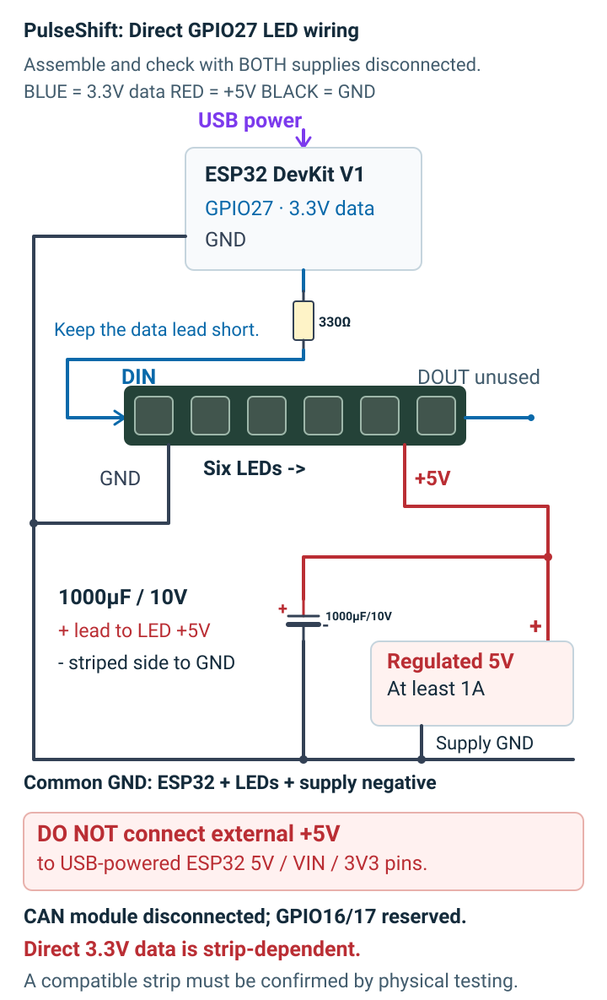

# PulseShift

Customizable ESP32 motorcycle shift-light firmware with six WS2812B LEDs, a standalone RPM demonstration, persistent offline CAN diagnostics, and passive raw CAN recording for reverse-engineering vehicle telemetry.

## Main features

- **Self-Contained Offline Operation:** No laptop, Wi-Fi, or Bluetooth needed on the motorcycle. Automatically logs CAN bus activity, errors, and system events to internal flash.
- **Standalone RPM Demo:** Progressive lighting bar and flashing shift alerts with smooth color transitions and customizable styles.
- **Passive CAN Field Capture:** Records raw broadcast CAN frames to LittleFS across three guided testing stages (Key ON / Engine Off, Idle, Revving).
- **One-Command Windows Retrieval:** High-speed log and raw capture export to CSV/JSON via PowerShell or Python over standard USB Serial.
- **Fail-Safe Shift Light:** Instant LED blanking on bus errors, stale data, or lost CAN communication.
- **Fail-Closed Architecture:** Hard-gated vehicle RPM logic that never synthesizes or guesses unverified CAN identifiers.

**No settings need changing for the standard demo:** six LEDs, GPIO27, brightness 40/255, Classic style and OLED off. No motorcycle or CAN connection is needed.

## What you need


- ESP32 DevKit V1 (ESP32-WROOM-32) and a USB **data** cable.
- One six-LED **5V WS2812B strip**, GRB / 800kHz.
- A **330Ω resistor** and **1000µF, 10V electrolytic capacitor**.
- A regulated **5V supply rated at least 1A**, secure wires and a multimeter.
- SN65HVD230 3.3V CAN transceiver (for CAN capture and vehicle modes).

The optional SN65HVD230 CAN module stays disconnected for the demo.

## How to wire it

Disconnect both supplies before assembly. Connect **GPIO27 → 330Ω → DIN**, with the resistor near the first LED. Keep the data lead short.



Connect to **DIN**, following the strip's printed arrow. Leave **DOUT** unconnected.


**USB powers the ESP32. External regulated 5V powers the LEDs.** Join the supply negative, LED GND and ESP32 GND. Never join external +5V to the USB-powered ESP32's 5V, VIN or 3V3 pins. Never power the strip from a GPIO.

Place the capacitor across LED +5V and GND: **positive to +5V, striped negative to GND**.


Check voltage, polarity and all connections before power-on. Power the LEDs before connecting USB; disconnect USB first when switching off. Let the capacitor discharge before rewiring.

## Download

**[Download PulseShift v0.3.0](https://github.com/iamaritrasaha/PulseShift/releases/tag/v0.3.0)**

[Arduino ZIP](https://github.com/iamaritrasaha/PulseShift/releases/download/v0.3.0/PulseShift-Arduino-v0.3.0.zip) · [SHA-256](https://github.com/iamaritrasaha/PulseShift/releases/download/v0.3.0/PulseShift-Arduino-v0.3.0.sha256) · [All releases](https://github.com/iamaritrasaha/PulseShift/releases)

For v0.3.0, download **PulseShift-Arduino-v0.3.0.zip** and **PulseShift-Arduino-v0.3.0.sha256** from Assets. Check the ZIP against its SHA-256 before extracting. Use the packaged Arduino ZIP, not GitHub's automatic source archive. Extract the archive and open **PulseShift/PulseShift.ino** in the Arduino IDE.

**v0.3.0 is the current verified software prerelease.** Physical motorcycle qualification remains pending.

## After upload


Expect a startup animation followed by a growing light bar and red flashing at the simulated shift point. Deliberate gaps in valid data make the LEDs go dark, then recover. **This demonstration does not measure engine RPM.**

## Configuration

Settings are configured in [PulseShift/UserConfig.h](PulseShift/UserConfig.h):

- **Operating Mode (`PULSESHIFT_OPERATING_MODE`):**
  - `PULSESHIFT_USER_MODE_DEMO` (Default): Autonomous desktop RPM simulation with six LEDs.
  - `PULSESHIFT_USER_MODE_CAN_CAPTURE`: Passive motorcycle CAN sniffing and LittleFS raw frame recording.
  - `PULSESHIFT_USER_MODE_VEHICLE_RPM`: Gated live motorcycle RPM shift light (requires qualified vehicle profile).
- **Brightness:** `PULSESHIFT_LED_BRIGHTNESS`, default **40**, range 0..255. This is not a hardware current limiter.
- **Style:** `PULSESHIFT_SHIFT_LIGHT_STYLE`, default **Classic**. (Options: `Racing`, `Minimal`, `Custom`).
- **Direction:** `PULSESHIFT_LED_DIRECTION`, default **Normal**. Reversal changes the pattern, not the DIN connection.

## Experimental CAN & Motorcycle Integration

**CAN_CAPTURE** records existing CAN frames without diagnostic requests. **VEHICLE_RPM** requires an independently verified profile and never substitutes demo RPM for missing data. GPIO16 and GPIO17 remain reserved for receiver work.

The **2025 Indian Bajaj Pulsar NS125 ABS** profile remains **UNVERIFIED**, with bitrate **0** and live decoding disabled. A scanner displaying RPM does not prove passive broadcasts or establish the diagnostic transport.

### Passive High-Speed SN65HVD230 Wiring
To maintain zero-impact electrical passivity at 500 kbps:
- **Pin 8 (Rs) → GND:** Enables Normal High-Speed mode ($\le 50\text{ns}$ loop delay required for reliable 500 kbps decoding).
- **Pin 1 (D / TXD) → 3.3V:** Hardware-enforced permanent recessive state.
- **GPIO17 (TX) → Disconnected:** Physically isolated; cannot transmit or acknowledge frames under any circumstances.
- **Pin 4 (R / RXD) → ESP32 GPIO16 (RX):** TWAI receive input.
- **120Ω Terminating Resistor Removed:** Transceiver module's onboard SMD termination must be desoldered so as not to load down the motorcycle's factory CAN bus.

## Offline Field Capture Workflow (Motorcycle Testing)

No computer, laptop, Wi-Fi, or Bluetooth is needed while testing on the motorcycle.

1. **Flash Capture Firmware:**
   ```powershell
   Set-Location "D:\Development\PulseShift-Firmware"
   .\build.ps1 -Target capture -Upload -Port COM3
   ```
2. **Mount ESP32 on Motorcycle:**
   Connect 3.3V power and ground, connect CAN_H and CAN_L, and turn the bike key ON.
3. **Stage 1 (Key ON, Engine OFF):**
   LED 2 turns Amber. Capture runs for 30–60 seconds to baseline idle network traffic.
4. **Stage 2 (Engine Idling):**
   Short-press the ESP32 **BOOT button** (GPIO0). LED 3 lights up. Idle the engine for 60 seconds.
5. **Stage 3 (Gentle Revving):**
   Short-press the **BOOT button** again. LED 4 lights up. Gently rev through RPM ranges (2000–5000 RPM).
6. **Stop Recording:**
   Press and hold the **BOOT button** for >2.5 seconds to commit and close the log session.

## Retrieving Saved Logs on Windows

When you return home, reconnect the ESP32 to Windows via USB:

```powershell
Set-Location "D:\Development\PulseShift-Firmware"
powershell -ExecutionPolicy Bypass -File .\export-logs.ps1
```

The script automatically detects your COM port, retrieves the status metadata, downloads the persistent diagnostic log (`diagnostics.log`), and exports all raw CAN frames to `can_capture.csv` with CRC16 verification.

## Testing & Verification

Run the full local automated test suite:

```powershell
Set-Location "D:\Development\PulseShift-Firmware"
powershell -ExecutionPolicy Bypass -File .\test-firmware.ps1
```

All 22 test suites cover native compilation across all four targets, symbol isolation (zero forbidden transmit symbols), CRC16 bitflip detection, LittleFS quota safety, first-boot blank flash formatting, BOOT button FSM, and 17 functional Python integration scenarios.

## Safety limitations

- Common ground, correct DIN direction and capacitor polarity are essential. Never change wiring while powered.
- PulseShift's standard demo sends data directly from GPIO27 through a 330Ω resistor. Some 5V WS2812B strips need a proper 74AHCT125 level shifter for reliable 3.3V data recognition. Separate LED power does not fix the signal-level mismatch; do not lower the rated LED supply voltage to compensate.
- Keep the CAN module disconnected until a qualified technician verifies the connector, transport, RS wiring, TXD bias, reset/unpowered passivity, termination and automotive protection. Software listen-only alone does not qualify the hardware.
- Motorcycle RPM integration and shift calibration are unverified. The demo's RPM thresholds are synthetic. This is a **software prerelease**, not a physically qualified motorcycle accessory.
- Wokwi DEMO does not validate physical CAN. The isolated TWAI test still has an unresolved transmission-completion limitation.

Copyright (c) 2026 Aritra Saha. All rights reserved. See [COPYRIGHT](COPYRIGHT).
