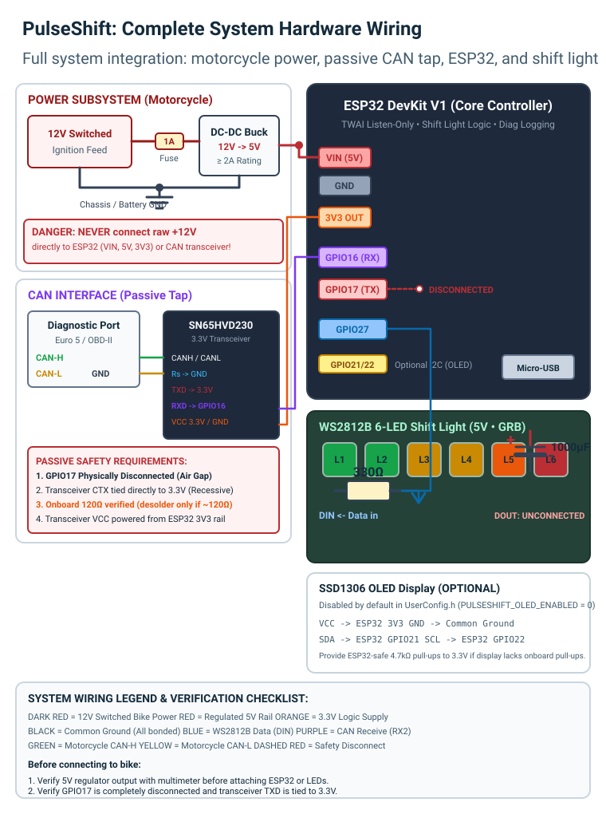
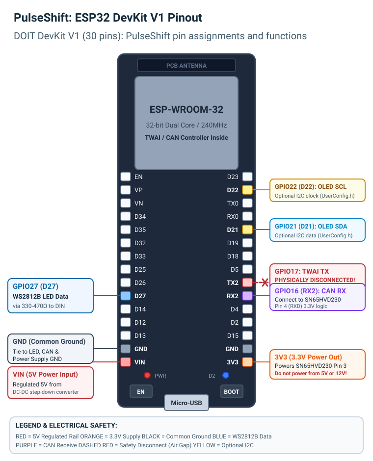
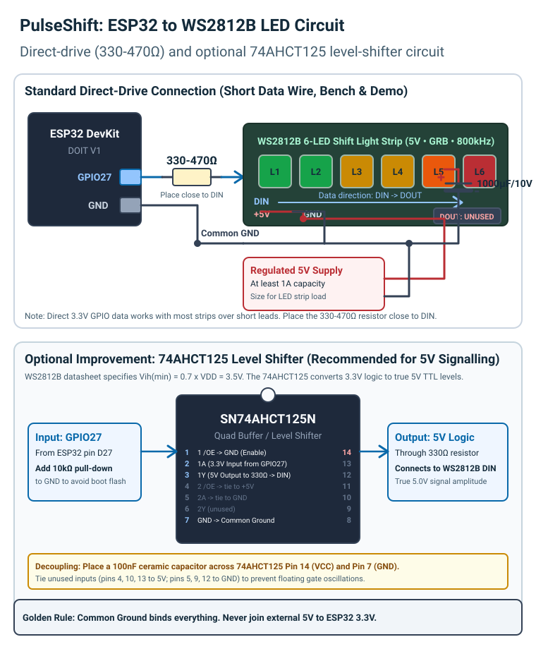
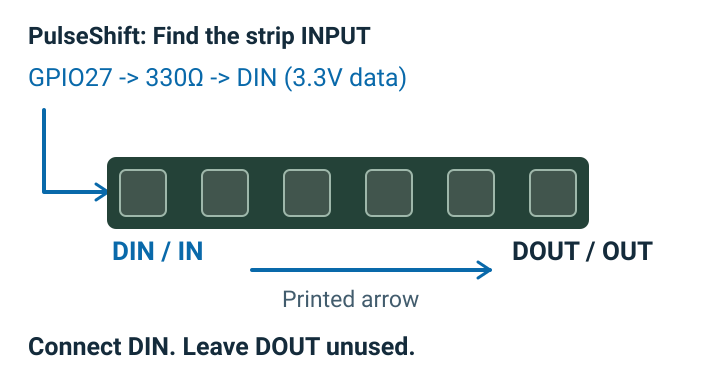
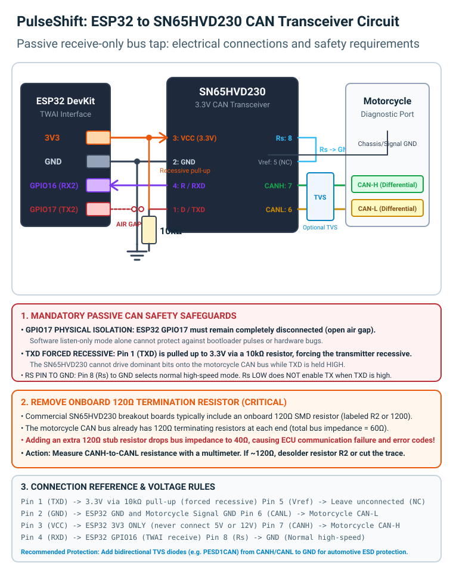
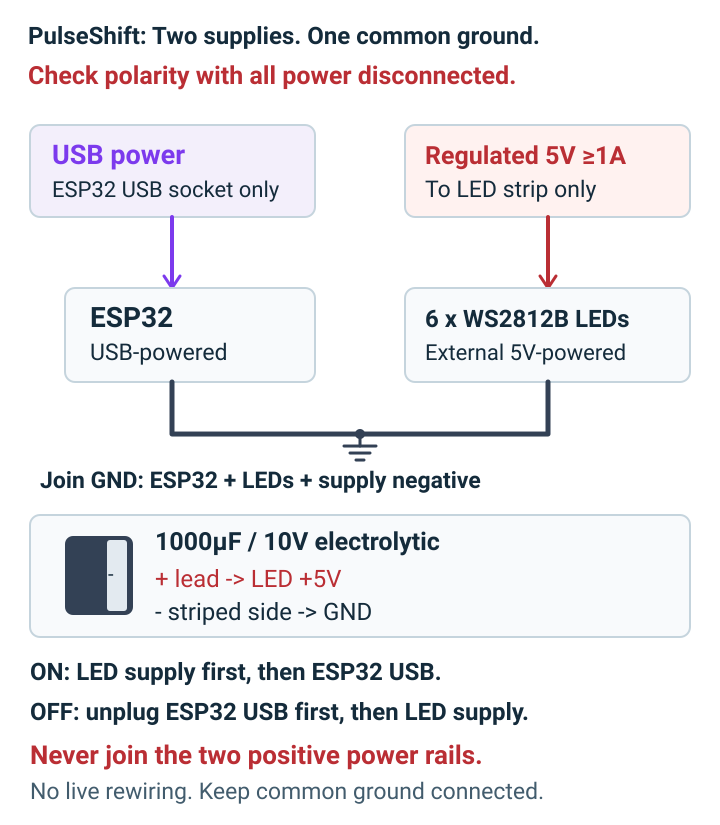

# PulseShift Hardware Reference

Comprehensive hardware specification, circuit diagrams, and electrical guidelines for the PulseShift ESP32 shift-light and CAN diagnostic logger.

Target vehicle context: **Bajaj Pulsar NS125 (2025 ABS model)**. Physical CAN bus acquisition was successfully verified on this vehicle at **500 kbps** (Session 2: 22,542 records across 3 stages, 18 distinct CAN IDs, 0 corrupt records, ~82.5s duration). Candidate engine-speed frames were identified at **arbitration ID 0x301, payload byte 0** (provisional multiplier 40.0). However, the **mathematical RPM calibration remains strictly UNVERIFIED** against an independent physical reference tachometer. Physical shift lights remain disabled until calibration is verified.

---

## 1. Complete System Wiring

The full PulseShift hardware system consists of four functional blocks:
1. **Power Subsystem**: Regulated 5V buck converter from motorcycle 12V switched ignition.
2. **Core Microcontroller**: DOIT ESP32 DevKit V1 (ESP-WROOM-32).
3. **Passive CAN Interface**: SN65HVD230 3.3V transceiver with physical transmission inhibitors.
4. **Shift Light Display**: Six WS2812B RGB LEDs with series resistor, bulk capacitor, and optional level shifter.



---

## 2. ESP32 DevKit V1 Pinout

The firmware targets the standard 30-pin DOIT ESP32 DevKit V1 board.



### Pin Mapping Table

| Board Pin | ESP32 GPIO | Net / Function | Connection Destination | Electrical Rules |
|---|---|---|---|---|
| D27 | GPIO27 | WS2812B Data | LED strip DIN (via 330-470 ohm resistor) | 3.3V logic (800 kHz NRZ); keep lead short |
| RX2 | GPIO16 | TWAI RX | Breakout CRX (Pin 4 / RXD) | 3.3V digital logic input from transceiver |
| TX2 | GPIO17 | TWAI TX | **PHYSICALLY DISCONNECTED** | Air gap; DO NOT connect to transceiver CTX (software cannot detect wiring) |
| 3V3 | 3.3V Rail | Logic VCC & TXD Clamp | Breakout VCC (Pin 3) & Breakout CTX (Pin 1 / TXD) | Directly powers transceiver and clamps CTX recessive (NO resistor) |
| VIN | 5V Rail | Power Input | Regulated 5V output from DC-DC converter | 5.0V input; do not exceed 5.5V |
| GND | Ground | Common GND | Power GND, LED GND, Transceiver GND, Bike GND | All system grounds must be securely bonded |
| D21 | GPIO21 | OLED SDA | Optional SSD1306 OLED SDA | 3.3V I2C data (disabled by default) |
| D22 | GPIO22 | OLED SCL | Optional SSD1306 OLED SCL | 3.3V I2C clock (disabled by default) |

---

## 3. WS2812B Shift Light Circuit

PulseShift drives six WS2812B addressable LEDs in series.



### Direct Drive vs Level Shifter

1. **Direct-Drive (Bench & Short Wire Runs)**:
   - ESP32 GPIO27 outputs 3.3V logic signals.
   - A **330 to 470 ohm series resistor** is installed as close as possible to the first LED's DIN pin. This resistor damps transmission line reflections, limits inrush current into the input protection diodes, and prevents ringing.
   - Most WS2812B strips accept 3.3V logic when powered from 5V, provided wire length is kept under 20 cm.

2. **Optional 74AHCT125 Level Shifter (Recommended for Vehicle Installations)**:
   - The WS2812B datasheet specifies minimum input high voltage as `Vih(min) = 0.7 * VDD = 3.5V` when powered at 5.0V.
   - Over longer automotive wiring harnesses or under temperature variations, 3.3V logic may cause flickering or dropped data frames.
   - An SN74AHCT125 powered at 5V reliably translates 3.3V logic to true 5.0V TTL levels (`Vih = 2.0V`, `Voh >= 3.8V`).
   - Pin 1 (1/OE) is grounded (active LOW buffer enable). Pin 2 (1A) connects to GPIO27 with an optional 10k ohm pull-down to ground. Pin 3 (1Y) outputs 5V data through the 330 ohm resistor to DIN. Pin 14 is decoupled to Pin 7 (GND) with a 100nF ceramic capacitor. Unused inputs are tied to 5V or GND.

### Power & Polarity Rules

- A **1000 uF / 10V (or 16V) electrolytic capacitor** must be installed directly across the LED strip +5V and GND power terminals. This prevents voltage dips during sudden current surges when all LEDs illuminate simultaneously.
- Always observe capacitor polarity: the positive (+) lead connects to +5V, and the negative striped (-) lead connects to GND.
- **Never connect external 5V to the ESP32 3.3V pin.**
- **Leave DOUT on the 6th LED completely unconnected.**



---

## 4. SN65HVD230 Passive CAN Circuit

PulseShift is strictly a passive CAN listener. It never transmits frames, acknowledges packets, or injects traffic onto the motorcycle's bus.



### Connection Requirements

| SN65HVD230 Breakout Pin | Chip Function | Connection Destination | Purpose & Safety Rule |
|---|---|---|---|
| Pin 1 / CTX | D / TXD | ESP32 3V3 Rail (Direct wire) | **Forced recessive**. Directly tied to 3.3V (NO resistor) so driver cannot transmit dominant bits. |
| Pin 2 / GND | GND | Common GND | Logic ground and reference for differential signals. |
| Pin 3 / 3V3 | VCC | ESP32 3V3 Pin | Powered strictly from regulated 3.3V. **Never connect to 5V or 12V.** |
| Pin 4 / CRX | R / RXD | ESP32 GPIO16 | Drives 3.3V digital logic (reconstructed CAN bits) into ESP32 TWAI RX. |
| Pin 5 / Vref | Vref | Not Connected (NC) | Nominal VCC/2 reference output. Leave open. |
| Pin 6 / CANL | CANL | Motorcycle CAN-L | Low-voltage differential bus line. |
| Pin 7 / CANH | CANH | Motorcycle CAN-H | High-voltage differential bus line. |
| Pin 8 / Rs | Rs | ESP32 GND (Ground) | **Normal high-speed receiver mode**. Enables full 1 Mbps bandwidth. |

### Transceiver Mode: Why Rs Connects to GND

The Texas Instruments SN65HVD230 datasheet specifies the behavior of Pin 8 (Rs):
- **Rs to GND (< 0.33 * VCC)**: Normal high-speed mode. The receiver and driver operate with standard propagation delays, supporting data rates up to 1 Mbps. On many commercial breakout boards, Rs is already tied to GND on the PCB; if no separate Rs pin is broken out, the board is hardwired for high-speed mode.
- **Rs through resistor to GND (10k to 100k ohm)**: Slope control mode. Limits slew rate to reduce EMI.
- **Rs to VCC (> 0.75 * VCC)**: Low-power standby mode. The driver is disabled, but the receiver enters a low-power listening state with high propagation delay, unsuitable for high-speed vehicle networks (e.g. 500 kbps).

**Important**: Connecting Rs to GND selects normal high-speed receiver operation. It does NOT enable transmission by itself. Passive listen-only safety is achieved through three independent hardware and software safeguards:
1. **Physical Air Gap on GPIO17**: ESP32 GPIO17 is physically disconnected from the transceiver CTX pin. Note that the ESP32 microcontroller cannot detect whether an external wire is physically present; physical air gap inspection is mandatory.
2. **Forced Recessive Bias via Direct 3.3V Connection**: Transceiver breakout pin `CTX` (Pin 1 / TXD) is connected directly to the ESP32 3V3 rail (NO 10k resistor). On CAN transceivers, a constant HIGH input clamps the differential driver permanently in the recessive (idle) state.
3. **TWAI Listen-Only Mode**: The ESP32 TWAI peripheral is initialized with `TWAI_MODE_LISTEN_ONLY`, which suppresses dominant ACK bits and error frames in the controller hardware.

### 120 Ohm Termination Resistor Considerations

Standard ISO 11898-2 CAN buses are terminated at both physical ends with 120 ohm resistors, resulting in a nominal bus impedance of 60 ohms:
$$\frac{1}{R_{total}} = \frac{1}{120\,\Omega} + \frac{1}{120\,\Omega} = \frac{1}{60\,\Omega} \implies R_{total} = 60\,\Omega$$

Because PulseShift connects as an intermediate stub tap to an existing, already terminated motorcycle network, the tap itself must not introduce a third terminating resistor:
$$\frac{1}{R_{total}} = \frac{1}{120\,\Omega} + \frac{1}{120\,\Omega} + \frac{1}{120\,\Omega} = \frac{1}{40\,\Omega} \implies R_{total} = 40\,\Omega$$

Dropping total bus resistance to 40 ohms increases transceiver current draw and can trigger ECU bus error warnings.

**Diagnostic Verification Procedure (Do not assume all boards have R2)**:
1. Unpower the SN65HVD230 breakout module and disconnect it from all wiring.
2. Measure the resistance across the module's `CANH` and `CANL` screw terminals / header pins using a digital multimeter.
3. **If resistance measures ~120 ohms**: Locate the onboard SMD termination resistor (often labeled `R2` or `1200`, or a trace jumper pad) and desolder it (or cut the trace jumper).
4. **If resistance measures open circuit / mega-ohms**: The breakout board was manufactured without a termination resistor. No desoldering is necessary.
5. *Bench Testing Note*: When bench testing with a standalone CAN node (e.g. an isolated ECU simulator without internal termination), a 120 ohm resistor must be present across the test bench bus.

---

## 5. Power Architecture & Automotive Protection



### Motorcycle Power Conditioning

A motorcycle electrical system experiences substantial voltage transients, including alternator ripple, inductive spikes from the ignition coil, and load dump surges (up to 40V+ when disconnecting battery under charge).

1. **Inline Fuse**: A 1A fast-blow fuse must be installed immediately downstream of the switched ignition feed (+12V switched).
2. **DC-DC Step-Down Buck Converter**: A high-efficiency automotive-rated buck converter steps +12V down to a stable 5.0V (minimum 2A capacity).
3. **Common Ground**: Motorcycle chassis/battery ground, buck converter ground, ESP32 GND, LED GND, and SN65HVD230 GND must all be bonded to a single common ground plane.
4. **Absolute Prohibition**: NEVER connect raw +12V motorcycle power directly to the ESP32 (VIN, 5V, or 3V3 pins) or to the SN65HVD230.

### PC USB Connection and In-Vehicle Investigation Safety

When capturing real motorcycle CAN data with a Windows PC connected to the ESP32:

1. **Laptop on Battery Power (Strictly Recommended)**:
   - Always run the recording laptop on its internal battery.
   - Do NOT connect the laptop charger to an AC mains wall outlet while the USB cable is attached to the motorcycle-connected ESP32. AC-earthed power bricks can establish ground potential loops between the building mains ground and the vehicle chassis, inducing damaging circulating currents through the thin USB ground shield and CP2102 chip.

2. **5V Power Rail Separation**:
   - The ESP32 DevKit V1 and SN65HVD230 are powered safely by the PC USB 5.0V bus.
   - The WS2812B 6-LED strip draws up to ~360mA at maximum brightness (255) and is powered by the vehicle 5V buck converter.
   - **DO NOT bridge the vehicle 5V buck converter output to the ESP32 VIN pin while USB is connected.** Backfeeding the PC USB port with vehicle buck converter power can trigger motherboard USB overcurrent protection or damage the USB-to-UART converter.
   - Only ground lines (ESP32 GND, buck converter GND, LED GND, vehicle chassis GND) must be connected together.

### Optional Automotive Transient Protection

For long-term reliability on an operating motorcycle:
- **CAN Bus TVS Diodes**: A bidirectional transient voltage suppressor diode array (such as Nexperia PESD1CAN or Littlefuse AQ24CAN) placed between CANH to GND and CANL to GND suppresses electrostatic discharge (ESD) and inductive spikes.
- **Power Rail TVS**: A unidirectional 18V TVS diode (e.g. SMBJ15A) across the DC-DC converter 12V input protects against vehicle voltage surges.

---

## 6. How the Circuit Works: Signal Path & Concepts

The signal flow from engine crankshaft rotation to visual shift light illumination proceeds as follows:

```text
[Motorcycle ECU]
       |
       v (Differential CAN electrical voltages: CAN-H ~3.5V, CAN-L ~1.5V)
[CAN Bus Lines]
       |
       v (Differential bus tap, no extra 120 ohm termination)
[SN65HVD230 Transceiver]
       |
       v (Single-ended 3.3V digital bitstream into GPIO16)
[ESP32 TWAI Controller]
       |
       v (Parsed CAN frames: 11/29-bit ID + 8 payload bytes)
[PulseShift RPM Decoder]
       |
       v (Decoded RPM integer, e.g. 4500 RPM)
[Shift Light Logic Engine]
       |
       v (Active pixel colors, progressive fill, shift alert)
[ESP32 GPIO27]
       |
       v (800 kHz precision timed NRZ pulses through 330 ohm resistor)
[WS2812B LED Strip (Pixels 1 to 6)]
```

### Distinguishing Key CAN & Engine Concepts

To assemble, calibrate, and troubleshoot this system effectively, understand the distinct functional layers:

1. **CAN Electrical Signals**:
   Physical voltages on the twisted-pair wire. A dominant bit is represented when CAN-H is pulled up to ~3.5V and CAN-L is pulled down to ~1.5V (differential voltage ~2.0V). A recessive bit occurs when both lines float at approximately 2.5V (differential voltage ~0.0V).

2. **CAN Frame Identifiers (CAN ID)**:
   A standard 11-bit (e.g. `0x301`) or extended 29-bit header at the start of each packet defining message identity and priority. In real acquisition on the 2025 Pulsar NS125 ABS, 18 distinct CAN IDs were recorded at 500 kbps across key-on, idling, and gentle throttle sweep stages.

3. **CAN Payload Bytes**:
   Up to 8 data bytes (`Byte 0` through `Byte 7`) contained within each frame. Real capture analysis identified **CAN ID 0x301, Payload Byte 0** as the primary candidate carrying engine speed data:
   - Key ON, Engine OFF: raw value `0`
   - Engine Idling (~1,400-1,600 RPM): raw value `35` to `40`
   - Gentle Throttle Sweeps: raw value climbing dynamically up to `240`

4. **Engine RPM Values & Provisional Scaling**:
   The calculated rotational speed of the engine crankshaft in revolutions per minute, derived by converting the candidate payload byte using a provisional multiplier:
   $$\text{Estimated RPM} = \text{Raw Byte Value} \times 40.0$$
   *Crucial safety distinction*: While the 40.0 multiplier yields ~1,400-1,600 RPM at idle and ~9,600 RPM at peak throttle sweeps (consistent with single-cylinder 125cc tachometer behavior), this calculation is **uncalibrated** against an independent physical reference tachometer. Physical shift lights must remain disabled in vehicle mode (`RPM_MAPPED=NO`) until calibration is verified.

5. **Shift-Light Thresholds**:
   Firmware configuration settings in `UserConfig.h` that determine LED illumination stages when RPM is verified:
   - `PULSESHIFT_RPM_REV_START` (default: 5000 RPM): Threshold where the first green LED illuminates.
   - Intermediate RPM steps: Progressive illumination through yellow warnings as RPM approaches redline.
   - `PULSESHIFT_RPM_SHIFT` (default: 8000 RPM): Threshold where all six LEDs flash red in unison.
   - `PULSESHIFT_RPM_HYSTERESIS` (default: 100 RPM): Deadband preventing flickering at threshold boundaries.

---

## 7. Pre-Connection Physical Verification Checklist

Before connecting PulseShift to any motorcycle:

1. [ ] **Measure 12V Regulator Output**: Verify with a multimeter that the buck converter outputs strictly 5.0V (+-0.2V) before connecting ESP32 or LEDs.
2. [ ] **Check 120 Ohm Bus Resistor**: Measure resistance across the unpowered SN65HVD230 breakout's `CANH` and `CANL` pins with a multimeter. If ~120 ohms is measured, locate and desolder the SMD termination resistor (often labeled `R2` or `1200`) or cut the trace jumper to avoid loading the vehicle bus down to 40 ohms. If open circuit, leave as is.
3. [ ] **Verify GPIO17 Physical Isolation**: Confirm that ESP32 GPIO17 has an air gap with no wire inserted in its header socket. Software cannot verify physical wire presence; manual inspection is mandatory.
4. [ ] **Verify CTX / TXD Direct Clamping**: Confirm that SN65HVD230 breakout `CTX` (Pin 1 / TXD) is connected directly to the ESP32 3V3 rail. No 10k resistor is used in the verified working configuration. This clamps the transceiver driver permanently recessive.
5. [ ] **Verify Rs Pin**: Check that Pin 8 (Rs) is tied to GND. On standard commercial breakout modules, this is connected to GND directly on the PCB for normal high-speed operation.
6. [ ] **Verify Common Ground**: Measure 0.0 ohms between ESP32 GND, power supply negative, LED GND, transceiver GND, and motorcycle signal ground.
7. [ ] **Verify LED Capacitor**: Confirm 1000 uF electrolytic capacitor polarity (+ lead to 5V rail, - lead to GND rail).
8. [ ] **Identify Bike Pins**: Probe the motorcycle diagnostic connector with a multimeter (key on, engine off) to locate CAN-H (~2.5V-3.0V to GND) and CAN-L (~2.0V-2.5V to GND). Do not rely solely on wire color.
